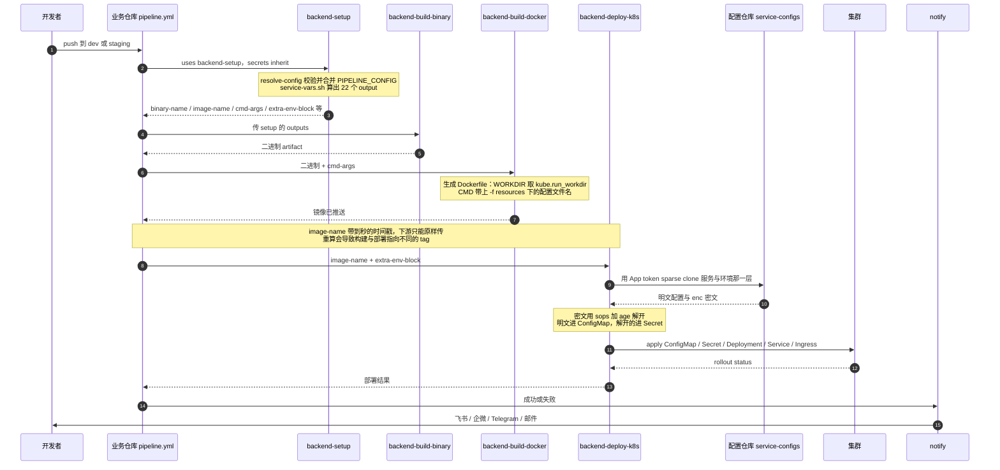

# 项目架构与脚本引用机制

> 本文是 [deploy-pipeline](../README.md) 文档的一部分

## 🏗️ 项目架构

```bash
deploy-pipeline/
├── .github/
│   ├── workflows/               # 可复用工作流
│   │   ├── code-quality.yml         # 代码质量检查
│   │   ├── cleanup-artifacts.yml   # Artifacts + GHCR 镜像清理
│   │   ├── backend-build-binary.yml # 编译 Go 二进制文件
│   │   ├── backend-build-docker.yml # 构建推送后端 Docker 镜像（tag 发布模式自动生成发布单）
│   │   ├── backend-deploy-k8s.yml   # K8s 部署（后端服务）
│   │   ├── frontend-build-frontend.yml # 前端构建（支持 npm/pnpm/yarn）
│   │   ├── frontend-build-docker.yml   # 构建推送前端 Docker 镜像（tag 发布模式自动生成发布单）
│   │   ├── frontend-deploy-k8s.yml     # K8s 部署（前端应用）
│   │   ├── release-note.yml           # tag 发布单（自动生成 GitHub Release）
│   │   ├── pr-opened-notify.yml       # PR 开启变更摘要通知
│   │   ├── pr-merged-notify.yml       # PR 合并通知
│   │   ├── branch-cut.yml             # 批量切分支（新迭代从 master 切 feature/xx）
│   │   ├── branch-recycle.yml         # dev 回收重切 + 已合并 feature 清理（周三发布后）
│   │   └── generate-config.yml        # 手动触发：打印默认配置 / 校验贴进来的配置
│   └── actions/                 # 可复用 Composite Actions
│       ├── resolve-config/      # 聚合 YAML 配置的校验 / 合并 / 导出（所有配置的唯一入口）
│       ├── resolve-service-vars/ # 一步算出服务流水线的全部变量（替掉调用方那 158 行 setup）
│       ├── fetch-pipeline-assets/ # 把本仓自带的 scripts/templates 放到工作区
│       ├── notify/              # 通用通知（飞书/企业微信/Telegram，支持自定义标题正文）
│       ├── update-proto-mod/    # 升级 go.mod 中 proto 模块引用并提 PR
│       ├── print-runner-info/   # 打印 Runner 环境信息
│       └── normalize-image-name/ # 镜像名规范与 tag 生成
├── scripts/                     # 公共脚本
│   ├── backend/                 # 后端脚本
│   │   └── build-linux.sh       # Go 构建脚本
│   ├── frontend/                # 前端脚本
│   │   └── build-frontend.sh    # 前端构建脚本
│   ├── config/
│   │   └── schema.yaml          # 配置表：所有配置项的唯一出处（键名/类型/默认值/旧变量名）
│   ├── resolve-config.py        # 聚合配置解析器，也可本地校验配置
│   ├── service-vars.sh          # 服务流水线变量计算（产物/镜像/部署决策/容器 env 列表）
│   ├── sync-fork.sh             # 同步到另一个组织下的那一份（只换组织前缀）
│   ├── branch-ops.sh            # 批量切分支 / dev 回收（gh api 实现，两个 workflow 共用）
│   ├── common.sh                # 通用函数库
│   └── notify.sh                # 飞书/企业微信/Telegram 通知
├── templates/                   # K8s 资源模板
│   └── k8s/                     # Kubernetes 模板
│       ├── backend/             # 后端服务模板
│       │   ├── deployment.yaml  # Deployment 模板
│       │   ├── service.yaml     # Service 模板
│       │   ├── hpa.yaml         # HPA 模板
│       │   └── ingress.yaml     # IngressRoute 模板
│       └── frontend/            # 前端应用模板
│           ├── deployment.yaml  # Deployment 模板
│           ├── service.yaml     # Service 模板
│           ├── hpa.yaml         # HPA 模板
│           └── ingress.yaml     # IngressRoute 模板
└── README.md                    # 项目文档
```

## 🔭 一次后端部署的全过程



每一步的细节见 [工作流列表与详细说明](02-workflows.md)

## 🔄 工作流脚本引用机制

公共 workflow 通过 `actions/checkout` 额外检出本仓库来获取脚本：

- **backend-build-binary.yml**: 优先使用项目自带 `scripts/backend/build-linux.sh`，不存在则使用公共仓库的
- **frontend-build-frontend.yml**: 优先使用项目自带 `scripts/frontend/build-frontend.sh`，不存在则使用公共仓库的
- **frontend-build-docker.yml**: 优先使用项目自定义 `nginx.conf`，不存在则使用默认配置
- **backend-deploy-k8s.yml / frontend-deploy-k8s.yml**: 通知功能使用公共仓库的 `scripts/notify.sh`

---
