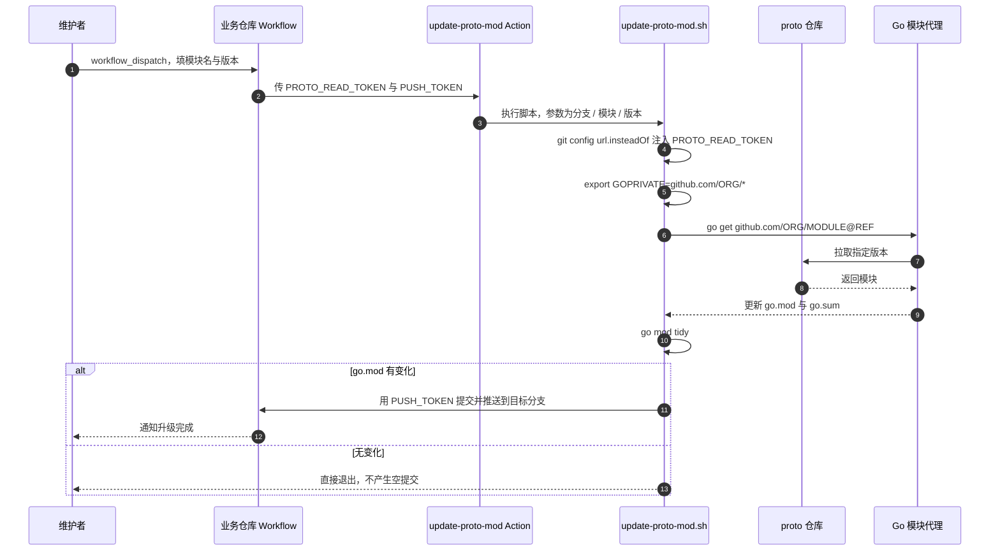

# 工作流列表与详细说明

> 本文是 [deploy-pipeline](../README.md) 文档的一部分

## 📋 工作流列表

| 分类 | 工作流 | 文件路径 | 说明 |
|------|--------|----------|------|
| **共享** | Code Quality | `code-quality.yml` | 代码格式检查、静态分析、单元测试 |
| **共享** | Cleanup | `cleanup-artifacts.yml` | 清理 Actions artifacts 和 GHCR 旧镜像 |
| **后端** | Build Binary | `backend-build-binary.yml` | 编译 Go 二进制文件（支持 UPX 压缩） |
| **后端** | Build Docker | `backend-build-docker.yml` | 构建并推送后端 Docker 镜像（含 Summary 报告） |
| **后端** | Deploy K8s | `backend-deploy-k8s.yml` | 部署后端服务到 Kubernetes |
| **前端** | Build Frontend | `frontend-build-frontend.yml` | 前端构建（支持 npm/pnpm/yarn） |
| **前端** | Build Docker | `frontend-build-docker.yml` | 构建并推送前端 Docker 镜像（含 Summary 报告） |
| **前端** | Deploy K8s | `frontend-deploy-k8s.yml` | 部署前端应用到 Kubernetes |
| **通知** | Release Note | `release-note.yml` | tag 发布模式构建成功后自动生成 GitHub Release 发布单 |
| **通知** | PR Opened Notify | `pr-opened-notify.yml` | PR 开启时推送变更摘要到飞书/企微/TG |
| **通知** | PR Merged Notify | `pr-merged-notify.yml` | PR 合并后推送通知到飞书/企微/TG |
| **分支管理** | Branch Cut | `branch-cut.yml` | 从基线批量切出新分支（多仓库一次完成） |
| **分支管理** | Branch Recycle | `branch-recycle.yml` | dev 回收重切 + 已合并 feature 分支清理 |
| **共享** | Generate Pipeline Config | `generate-config.yml` | 按 schema 生成带注释的配置示例与密钥模板 |
| **Go 库** | Library Test | `go-library-test.yml` | Go 库的测试流水线：矩阵自动推导 + Build/Vet 闸门 |
| **Go 库** | Bump Upstream | `go-bump-upstream.yml` | 收到上游发版通知后升 go.mod，**过了闸门才推主干** |
| **Go 库** | Trigger Downstream | `go-trigger-downstream.yml` | 发 tag 后通知一级下游，清单由依赖图自动推导 |
| **Go 库** | Bootstrap | `golib-bootstrap.yml` | 体检并下发各库的接入状态与 App 凭证 |
| **Go 库** | Dep Watch | `go-dep-watch.yml` | 盯指定三方模块的升级，给出内容 diff 与值探针对比 |

> GitHub reusable workflow 的 `uses:` 目标必须直接位于 `.github/workflows/` 顶层，不能放在 `backend/`、`frontend/`、`shared/` 等二级目录

---

## 📖 工作流详细说明


**跨仓库升级时序**：



> 两个令牌职责不同：`PROTO_READ_TOKEN` 只需要对 proto 仓库有读权限，
> `PUSH_TOKEN` 需要对**当前仓库**有写权限
> 混用一个全权令牌能跑通，
> 但一旦泄露影响面要大得多


### 共享工作流

#### Code Quality

代码质量检查：gofmt + go vet + 单元测试 + 覆盖率报告

| 参数 | 类型 | 必填 | 默认值 | 说明 |
|------|------|------|--------|------|
| `go-version` | string | 否 | `1.25.1` | Go 版本 |
| `gotestsum-version` | string | 否 | `v1.13.0` | gotestsum 版本 |
| `goproxy` | string | 否 | `https://goproxy.cn\|direct` | Go 模块代理 |
| `goprivate` | string | 否 | `''` | 私有模块路径 |
| `go-auth-method` | string | 否 | `none` | 私有模块认证方式（同 Build Binary） |
| `retention-days` | string | 否 | `7` | 构建产物保留天数 |

**所需 Secrets（当 `goprivate` 非空时）：**

| Secret | 认证方式 | 说明 |
|--------|----------|------|
| `APP_ID` | `app-token` | GitHub App ID |
| `APP_PRIVATE_KEY` | `app-token` | GitHub App 私钥 |
| `GIT_SSH_PRIVATE_KEY` | `ssh` | SSH 私钥（Legacy） |

#### Cleanup

清理 Actions artifacts 和 GHCR 旧版本镜像，支持独立开关和按保留天数/版本数清理

**Artifacts 清理参数：**

| 参数 | 类型 | 必填 | 默认值 | 说明 |
|------|------|------|--------|------|
| `cleanup-artifacts` | boolean | 否 | `true` | 是否清理 Actions artifacts |
| `keep-days` | string | 否 | `7` | 保留最近 N 天的 artifacts |

**GHCR 镜像清理参数：**

| 参数 | 类型 | 必填 | 默认值 | 说明 |
|------|------|------|--------|------|
| `cleanup-images` | boolean | 否 | `false` | 是否清理 GHCR 镜像 |
| `project-owner` | string | 否 | `''` | GitHub 组织/用户名（cleanup-images 为 true 时必填） |
| `image-name` | string | 否 | `''` | 镜像名（逗号分隔多个，留空则自动扫描所有 container packages） |
| `keep-count` | string | 否 | `5` | 保留镜像版本数 |
| `tag-include-prefix` | string | 否 | `''` | 仅清理 tag 命中前缀的镜像版本（逗号分隔，如 `dev,uat,sit`）；每个前缀分组各自保留最新 `keep-count` 个；留空回退 `vars.CLEANUP_TAG_INCLUDE_PREFIX` |
| `tag-exclude-prefix` | string | 否 | `v,prod` | 永不清理 tag 命中前缀的镜像版本（逗号分隔），命中的版本也不占用保留名额；留空回退 `vars.CLEANUP_TAG_EXCLUDE_PREFIX`，仍未配置时默认豁免发布 tag 前缀 `v,prod`（发布镜像永不清理，保障可回滚） |

**调用示例：**

```yaml
# 只清理 artifacts
cleanup:
  uses: HitGameAI/deploy-pipeline/.github/workflows/cleanup-artifacts.yml@d3798f49355acd52c79c0fc85fc74b31ece20f6d
  with:
    cleanup-artifacts: true
    keep-days: '7'

# 同时清理 artifacts + 指定镜像
cleanup:
  uses: HitGameAI/deploy-pipeline/.github/workflows/cleanup-artifacts.yml@d3798f49355acd52c79c0fc85fc74b31ece20f6d
  with:
    cleanup-artifacts: true
    keep-days: '7'
    cleanup-images: true
    project-owner: 'your-org'
    image-name: 'your-service'
    keep-count: '5'

# 扫描清理所有镜像（image-name 留空）
cleanup:
  uses: HitGameAI/deploy-pipeline/.github/workflows/cleanup-artifacts.yml@d3798f49355acd52c79c0fc85fc74b31ece20f6d
  with:
    cleanup-images: true
    project-owner: 'your-org'
    image-name: ''
    keep-count: '5'

# 清理多个指定镜像（逗号分隔）
cleanup:
  uses: HitGameAI/deploy-pipeline/.github/workflows/cleanup-artifacts.yml@d3798f49355acd52c79c0fc85fc74b31ece20f6d
  with:
    cleanup-images: true
    project-owner: 'your-org'
    image-name: 'tenant-admin,ops-admin'
    keep-count: '5'
```

**Tag 前缀过滤说明：**

- 镜像 tag 由调用方在构建时拼接（如 `${branch}-${commit}-${timestamp}`），前缀即分支/环境名（dev/uat/sit…）
- `tag-include-prefix`（白名单）：仅清理命中前缀的版本，每个前缀各自保留最新 `keep-count` 个，避免高频环境把低频环境的保留名额挤掉；未命中任何前缀的版本（如 prod/master）不清理
- `tag-exclude-prefix`（黑名单）：命中前缀的版本永不清理；两者可同时配置，exclude 优先保护；**未配置时默认豁免发布 tag 前缀 `v,prod`，发布镜像（tag 发布模式产物）永不参与清理**
- untagged（dangling）版本不受前缀过滤影响，始终清理
- 配置优先级：`inputs > vars.CLEANUP_TAG_INCLUDE_PREFIX` / `vars.CLEANUP_TAG_EXCLUDE_PREFIX` > 默认值 `v,prod`（仅 exclude；仓库级 GitHub Variables 设置后无需修改 pipeline）

```yaml
# 只清理 dev/uat/sit 前缀的旧镜像，其他前缀（prod/master 等）不动
cleanup:
  uses: HitGameAI/deploy-pipeline/.github/workflows/cleanup-artifacts.yml@d3798f49355acd52c79c0fc85fc74b31ece20f6d
  with:
    cleanup-images: true
    project-owner: 'your-org'
    keep-count: '5'
    tag-include-prefix: 'dev,uat,sit'

# 反向：清理所有旧镜像，但 prod/master 前缀的版本永不清理
cleanup:
  uses: HitGameAI/deploy-pipeline/.github/workflows/cleanup-artifacts.yml@d3798f49355acd52c79c0fc85fc74b31ece20f6d
  with:
    cleanup-images: true
    project-owner: 'your-org'
    keep-count: '5'
    tag-exclude-prefix: 'prod,master'
```

#### Generate Pipeline Config

接入新服务时不用翻文档抄配置项：到 Actions 里手动触发它，带注释的默认配置会整份打到
job summary 里（明文那份 + 密钥骨架），顺手上传成 artifact，直接贴进仓库变量即可
已经写好的配置也可以贴进来让它校验，省得推一次流水线才发现键名拼错

| 入参 | 必填 | 默认 | 说明 |
|------|------|------|------|
| `mode` | ❌ | `generate` | `generate` 打印默认配置 / `validate` 校验 `config` 里贴进来的 YAML |
| `sections` | ❌ | `''` | 只要这几节（空格分隔），留空＝全部 |
| `config` | ❌ | `''` | `validate` 模式下待校验的 YAML |

`validate` 模式不用先说明「这是哪一节」：先按总表校，不匹配就逐节试一遍，
都不匹配才报错，并给出具体路径与「是否想写」建议

generate 出来的东西自己会过一遍校验 —— 示例要是都通不过，说明配置表本身有问题

### 分支管理工作流

周节奏 SOP 的分支工程化：周三上线发布后 dev 回收重切（git 树每周归零）+ 新迭代从最新 master 切 feature

#### Branch Recycle（dev 回收重切 + 已合并 feature 清理）

**动作序列**（每仓库）：

1. 前置检查（可选开启）：今日存在 `prod-YYYY.MM.DD*` tag（确认发布已完成，未发布自动跳过）
2. dev 状态检查：`compare master...dev` 为 `identical/behind`（无未发布内容）才回收；`ahead/diverged` 自动**拒绝**并列出领先提交数（其他项目未发布变更，人工决策）
3. 删 dev → 从 master 重切（`dev` 不存在则直接新建，首次接入场景）
4. feature 清理：删除已完全合入 master 的 `feature/*` 分支，未合并的保留并列出

**安全设计**：

| 机制 | 说明 |
|---|---|
| 干跑预告 | 周三 21:00（北京时间）schedule 自动**干跑**，推预告卡片到群；真执行必须人工 `workflow_dispatch` 以 `dry-run=false` 确认——删分支永不无人值守 |
| 拒绝即停 | dev 领先 master（有未发布内容）自动拒绝该仓库，不误删其他项目变更 |
| 发布完成检查 | `require-today-tag=true` 时，今日无 `prod-*` tag 的仓库跳过（晚发布自动顺延到下次） |
| 幂等 | `dev` 缺失自动新建；重复触发安全 |

**触发方式**：

| 方式 | 场景 | dry-run |
|---|---|---|
| `schedule`（周三 21:00） | 自动干跑推预告卡片到群 | 恒为 true |
| `workflow_dispatch` | 人工确认执行（`dry-run=false`）或手动干跑 | 按 input |
| `workflow_call` | 单仓库自助模式（调用方 GITHUB_TOKEN 操作自己分支） | 按 input |

**参数**：

| 参数 | 类型 | 必填 | 默认值 | 说明 |
|------|------|------|--------|------|
| `repos` | string | 否 | `''` | 仓库列表（逗号分隔 owner/repo；留空回退 `branch.repos` 配置，再回退当前仓库） |
| `source-branch` | string | 否 | `master` | 源分支（重切基点） |
| `target-branch` | string | 否 | `dev` | 回收目标分支 |
| `feature-prefix` | string | 否 | `feature/` | 要清理的 feature 分支前缀 |
| `clean-features` | boolean | 否 | `true` | 是否清理已合并 feature 分支 |
| `require-today-tag` | boolean | 否 | call: `false` / dispatch: `true` | 是否要求今日存在 `prod-YYYY.MM.DD*` tag 才回收 |
| `dry-run` | boolean | 否 | call: `true` / dispatch: `false` | 干跑模式（schedule 恒为干跑） |
| `notification-provider` | string | 否 | `feishu` | 通知渠道：feishu / telegram / all / none |

**配置要求**（中心批量模式，在 deploy-pipeline 仓库配置一次）：

```yaml
# vars.PIPELINE_CONFIG（或 vars.BRANCH_CONFIG）
branch:
  repos: service-a,service-b,service-c
  source_branch: master
  target_branch: dev
  feature_prefix: feature/
  clean_features: true

# secrets.PIPELINE_SECRETS
branch:
  token: ghp_xxxx          # PAT 或 GitHub App token，需覆盖全部目标仓库
notify:
  feishu_webhook_url: https://open.feishu.cn/open-apis/bot/v2/hook/xxxx
```

旧式单个变量 `vars.BRANCH_OPS_REPOS` / `secrets.BRANCH_OPS_TOKEN` 仍然有效，
优先级在聚合 YAML 之下，详见[配置章节](#-配置一份聚合-yaml)
`branch.token` 留空时回退本次运行的 `GITHUB_TOKEN`，那只够操作当前仓库，跨仓库批量会 404

**调用示例**：

```yaml
# 单仓库自助模式（在业务仓库 pipeline.yml 中，用自己 GITHUB_TOKEN）
branch-recycle:
  uses: HitGameAI/deploy-pipeline/.github/workflows/branch-recycle.yml@d3798f49355acd52c79c0fc85fc74b31ece20f6d
  with:
    clean-features: true
    dry-run: false
    notification-provider: 'feishu'
  secrets: inherit
```

```yaml
# 中心批量模式（在 deploy-pipeline 仓库手动 dispatch，或 schedule 自动预告）
# inputs.repos: service-a,service-b,service-c,...（留空用 branch.repos）
# dry-run=false 执行；require-today-tag=true 检查发布完成
```

#### Branch Cut（批量切分支）

新迭代启动（周三发布后定下版本内容）：从最新 master 给一批仓库统一切出 `feature/xx`

| 参数 | 类型 | 必填 | 默认值 | 说明 |
|------|------|------|--------|------|
| `repos` | string | 否 | `''` | 仓库列表（逗号分隔；留空回退 `branch.repos` 配置） |
| `new-branch` | string | 是 | - | 新分支名（如 `feature/xxx`） |
| `base-branch` | string | 否 | `master` | 基分支 |
| `dry-run` | boolean | 否 | `false` | 干跑模式 |
| `notification-provider` | string | 否 | `feishu` | 通知渠道 |

幂等：目标分支已存在的仓库自动跳过
切完自动推结果卡片，替代群里人肉喊"大家切分支了"

```yaml
# 在 deploy-pipeline 仓库手动 dispatch：new-branch=feature/xxx，repos 留空用 branch.repos
```

#### branch-ops.sh（脚本直用）

两个 workflow 共用 `scripts/branch-ops.sh`（workflow 里经 fetch-pipeline-assets 取到 `_deploy-workflows/scripts/branch-ops.sh`，本地直接跑仓库里的那份）：

```bash
export GH_TOKEN="<PAT>"                      # 跨仓库用 PAT；单仓库用 GITHUB_TOKEN
export BRANCH_OPS_REPOS="org/repo-a,org/repo-b"
export BRANCH_OPS_DRY_RUN=true               # 干跑

bash scripts/branch-ops.sh recycle            # 回收模式
# 附加 env: BRANCH_OPS_SOURCE / BRANCH_OPS_TARGET / BRANCH_OPS_FEATURE_PREFIX /
#          BRANCH_OPS_CLEAN_FEATURES / BRANCH_OPS_REQUIRE_TAG

bash scripts/branch-ops.sh cut                # 切分支模式
# 附加 env: BRANCH_OPS_NEW_BRANCH=feature/xxx / BRANCH_OPS_BASE=master
```

### 后端工作流

#### Build Binary

编译 Go 二进制文件，支持交叉编译和 UPX 压缩

| 参数 | 类型 | 必填 | 默认值 | 说明 |
|------|------|------|--------|------|
| `go-version` | string | 是 | - | Go 版本 |
| `binary-name` | string | 是 | - | 二进制文件名 |
| `binary-source-dir` | string | 是 | - | 二进制输出目录 |
| `binary-output` | string | 是 | - | 二进制完整输出路径 |
| `version` | string | 是 | - | 版本号 |
| `build-time` | string | 是 | - | 构建时间 |
| `git-commit` | string | 是 | - | Git commit hash |
| `goproxy` | string | 否 | `https://goproxy.cn\|direct` | Go 模块代理 |
| `goprivate` | string | 否 | `''` | 私有模块路径（如 `github.com/your-org/*`） |
| `go-auth-method` | string | 否 | `none` | 私有模块认证方式，详见下方说明 |
| `os` | string | 否 | `linux` | 目标操作系统 |
| `arch` | string | 否 | `amd64` | 目标架构（`amd64` 或 `arm64`，每次构建只产出对应架构一个二进制；K8s 集群含 arm64 节点时传 `arm64` 用 Go 交叉编译） |
| `upx-compress` | string | 否 | `false` | 是否启用 UPX 压缩 |
| `retention-days` | string | 否 | `7` | 构建产物保留天数 |

**所需 Secrets：**

| Secret | 认证方式 | 说明 |
|--------|----------|------|
| `APP_ID` | `app-token` | GitHub App ID |
| `APP_PRIVATE_KEY` | `app-token` | GitHub App 私钥 |
| `GIT_SSH_PRIVATE_KEY` | `ssh` | SSH 私钥（Legacy） |

---

#### 🔐 Go 私有模块认证（`go-auth-method`）

当项目依赖私有 Go 模块（通过 `goprivate` 指定）时，CI 需要认证才能拉取
`go-auth-method` 支持三种方式：

| 值 | 说明 | Secrets | 安全性 |
|-----|------|---------|--------|
| `app-token` | **推荐** — 使用 GitHub App 动态生成短期 Token | `APP_ID` + `APP_PRIVATE_KEY` | ⭐⭐⭐ Token 自动过期，权限可细粒度控制 |
| `ssh` | 传统方式 — 使用 SSH 私钥拉取 | `GIT_SSH_PRIVATE_KEY` | ⭐⭐ 私钥长期有效，需手动轮换 |
| `none` | 不需要认证（公开仓库或已有其他认证） | 无 | — |

**优先级链：** `input > vars.GO_AUTH_METHOD > 'none'`

**`app-token` 方式工作原理：**

1. 使用 `actions/create-github-app-token@v1` 由 `APP_ID` + `APP_PRIVATE_KEY` 生成临时 Token
2. 自动配置 `git config --global url."https://x-access-token:<token>@github.com/".insteadOf "https://github.com/"`
3. Token 仅在当前 Job 生命周期内有效，Job 结束自动失效

**GitHub App 配置步骤：**

1. 前往 GitHub → Settings → Developer settings → GitHub Apps → New GitHub App
2. 设置 Permissions：Contents → Read-only（拉取私有仓库）
3. 安装 App 到目标组织/仓库
4. 将 App ID 存入仓库 Secret `APP_ID`
5. 将 App 生成的 Private Key 存入仓库 Secret `APP_PRIVATE_KEY`

**`ssh` 方式工作原理：**

1. 使用 `webfactory/ssh-agent@v0.9.0` 加载 SSH 私钥
2. 配置 `git config --global url."git@github.com:".insteadOf "https://github.com/"`
3. 私钥永不过期，需定期手动轮换

**调用示例：**

```yaml
# 推荐：App Token 方式
build-binary:
  uses: HitGameAI/deploy-pipeline/.github/workflows/backend-build-binary.yml@d3798f49355acd52c79c0fc85fc74b31ece20f6d
  with:
    binary-name: 'my-service'
    goprivate: 'github.com/my-org/*'
    go-auth-method: 'app-token'
  secrets:
    APP_ID: ${{ secrets.APP_ID }}
    APP_PRIVATE_KEY: ${{ secrets.APP_PRIVATE_KEY }}

# Legacy：SSH 方式
build-binary:
  uses: HitGameAI/deploy-pipeline/.github/workflows/backend-build-binary.yml@d3798f49355acd52c79c0fc85fc74b31ece20f6d
  with:
    binary-name: 'my-service'
    goprivate: 'github.com/my-org/*'
    go-auth-method: 'ssh'
  secrets:
    GIT_SSH_PRIVATE_KEY: ${{ secrets.GIT_SSH_PRIVATE_KEY }}
```

#### Build Docker (Backend)

构建后端 Docker 镜像并推送到镜像仓库

| 参数 | 类型 | 必填 | 默认值 | 说明 |
|------|------|------|--------|------|
| `binary-name` | string | 是 | - | 二进制文件名 |
| `version` | string | 是 | - | 版本号 |
| `http-port` | string | 是 | - | HTTP 端口 |
| `rpc-port` | string | 是 | - | gRPC 端口 |
| `ws-port` | string | 否 | `''` | WebSocket 端口（可选） |
| `ws-deployment-mode` | string | 否 | `combined` | WebSocket 部署模式：combined（混合）或 separate（独立） |
| `ws-app-name` | string | 否 | `${binary-name}-ws` | WebSocket 独立部署的应用名称 |
| `pprof-port` | string | 是 | - | Pprof 端口 |
| `docker-registry` | string | 是 | - | 镜像仓库地址 |
| `binary-source-dir` | string | 是 | - | 二进制文件目录 |
| `image-base` | string | 是 | - | 基础镜像名（不带 tag） |
| `image-name` | string | 是 | - | 完整镜像名（带 tag） |
| `arch` | string | 否 | `amd64` | 目标架构（`amd64` 或 `arm64`），需与 build-binary 一致；build-push-action 用 `linux/${arch}` 标记 manifest，K8s 才能调度到对应架构节点 |
| `extra-copy-dirs` | string | 否 | `''` | 额外拷贝到 Docker 镜像的目录（逗号分隔，支持 `src:dest` 格式，如 `proto` 或 `proto:./proto,locales:./locales`） |

**所需 Secrets：**

| Secret | 必填 | 说明 |
|--------|------|------|
| `DOCKER_USERNAME` | 否 | 镜像仓库用户名，默认 `github.actor` |
| `DOCKER_PASSWORD` | 否 | 镜像仓库密码/Token，默认 `GITHUB_TOKEN` |

#### Deploy K8s (Backend)

部署后端服务到 Kubernetes 集群

| 参数 | 类型 | 必填 | 默认值 | 说明 |
|------|------|------|--------|------|
| `environment` | string | 是 | - | 部署环境（用作 K8s namespace） |
| `image-name` | string | 是 | - | 完整镜像名（带 tag） |
| `binary-name` | string | 是 | - | 服务名 |
| `kind` | string | 否 | `Deployment` | Kubernetes workload 类型：Deployment/StatefulSet/DaemonSet |
| `service-kind` | string | 否 | `Service` | Kubernetes Service kind 类型 |
| `service-type` | string | 否 | `ClusterIP` | Kubernetes Service 暴露类型：ClusterIP/NodePort/LoadBalancer |
| `http-port` | string | 是 | - | HTTP 端口 |
| `rpc-port` | string | 是 | - | gRPC 端口 |
| `ws-port` | string | 否 | `''` | WebSocket 端口（可选） |
| `pprof-port` | string | 是 | - | Pprof 端口 |
| `config-yaml` | string | 否 | `''` | 配置文件路径 |
| `configmap-name` | string | 否 | `''` | ConfigMap 名称 |
| `enable-hpa` | string | 否 | `true` | 是否启用 HPA |
| `ingress-path-prefix` | string | 否 | `''` | Ingress 路径前缀 |
| `notification-provider` | string | 否 | `none` | 通知方式：`none`/`feishu`/`wecom`/`telegram`/`all` |

**所需环境级 Secrets：**

| Secret | 必填 | 说明 |
|--------|------|------|
| `PIPELINE_SECRETS` | 否 | 聚合密钥 YAML，`kube.kubeconfig` 可代替下面的 `KUBECONFIG` |
| `KUBECONFIG` | 是（或由 `PIPELINE_SECRETS` 提供） | K8s 集群配置 |
| `FEISHU_WEBHOOK_URL` | 否 | 飞书通知 Webhook URL |
| `WECOM_WEBHOOK_URL` | 否 | 企业微信群机器人 Webhook URL（完整地址） |
| `WECOM_WEBHOOK_KEY` | 否 | 企业微信群机器人 key（与 URL 二选一） |
| `TELEGRAM_BOT_TOKEN` | 否 | Telegram Bot Token |
| `TELEGRAM_CHAT_ID` | 否 | Telegram 聊天群组 ID |

### 前端工作流

#### Build Frontend

前端构建，支持 npm、pnpm、yarn 三种包管理器

| 参数 | 类型 | 必填 | 默认值 | 说明 |
|------|------|------|--------|------|
| `node-version` | string | 是 | - | Node.js 版本 |
| `version` | string | 是 | - | 构建版本号 |
| `build-time` | string | 是 | - | 构建时间戳 |
| `git-commit` | string | 是 | - | Git commit hash |
| `package-manager` | string | 否 | `npm` | 包管理器：npm/pnpm/yarn |
| `package-registry` | string | 否 | `https://registry.npmmirror.com` | 包管理器仓库地址 |
| `build-command` | string | 否 | `npm run build` | 构建命令（monorepo 可传 `pnpm run build:xxx`） |
| `output-dir` | string | 否 | `dist` | 构建输出目录 |
| `artifact-name` | string | 否 | `frontend-dist` | 构建产物 Artifact 名称（多应用并行构建时需区分） |
| `pnpm-version` | string | 否 | `8` | pnpm 版本（仅 package-manager 为 pnpm 时生效） |
| `retention-days` | string | 否 | `7` | 构建产物保留天数 |

#### Build Docker (Frontend)

构建前端 Docker 镜像（基于 Nginx）

| 参数 | 类型 | 必填 | 默认值 | 说明 |
|------|------|------|--------|------|
| `app-name` | string | 是 | - | 前端应用名称 |
| `version` | string | 是 | - | 版本号 |
| `http-port` | string | 否 | `80` | HTTP 端口 |
| `docker-registry` | string | 是 | - | 镜像仓库地址 |
| `image-base` | string | 是 | - | 基础镜像名（不带 tag） |
| `image-name` | string | 是 | - | 完整镜像名（带 tag） |
| `base-image` | string | 否 | `nginx:1.25.3-alpine` | 基础 Nginx 镜像 |
| `nginx-config-path` | string | 否 | `''` | 项目自定义 nginx.conf 路径 |
| `artifact-name` | string | 否 | `frontend-dist` | 构建产物 Artifact 名称（需与 build-frontend 一致） |
| `os` | string | 否 | `linux` | 目标 OS |
| `arch` | string | 否 | `amd64` | 目标架构（`amd64` / `arm64`），与 `os` 拼成 `${os}/${arch}` 传给 build-push-action 的 platforms |

#### Deploy K8s (Frontend)

部署前端应用到 Kubernetes 集群

| 参数 | 类型 | 必填 | 默认值 | 说明 |
|------|------|------|--------|------|
| `environment` | string | 是 | - | 部署环境（用作 K8s namespace） |
| `image-name` | string | 是 | - | 完整镜像名（带 tag） |
| `app-name` | string | 是 | - | 应用名称 |
| `http-port` | string | 否 | `80` | HTTP 端口 |
| `ingress-path-prefix` | string | 否 | `''` | Ingress 路径前缀 |
| `enable-hpa` | string | 否 | `true` | 是否启用 HPA |
| `notification-provider` | string | 否 | `none` | 通知方式：`none`/`feishu`/`wecom`/`telegram`/`all` |

**所需环境级 Secrets：**

| Secret | 必填 | 说明 |
|--------|------|------|
| `KUBECONFIG` | 是 | K8s 集群配置 |
| `FEISHU_WEBHOOK_URL` | 否 | 飞书通知 Webhook URL |
| `WECOM_WEBHOOK_URL` | 否 | 企业微信群机器人 Webhook URL（完整地址） |
| `WECOM_WEBHOOK_KEY` | 否 | 企业微信群机器人 key（与 URL 二选一） |
| `TELEGRAM_BOT_TOKEN` | 否 | Telegram Bot Token |
| `TELEGRAM_CHAT_ID` | 否 | Telegram 聊天群组 ID |

---

---

### Go 库工作流

三十来个 Go 库共用这三条流水线加一个接入工具，调用方仓库里只放一个瘦入口
背景与事故记录见 [Go 库流水线](05-go-library-pipeline.md)，这里是逐项的参数与行为说明

#### 🧪 Go Library Test（`go-library-test.yml`）

`workflow_call`，挂在调用方的 push 还是 pull_request 由调用方决定
两个 job：`config`（解析配置、推导矩阵）→ `test`（矩阵跑测）

| 入参 | 类型 | 必填 | 默认值 | 说明 |
|------|------|------|--------|------|
| `go-versions` | string | ❌ | `''` | JSON 数组，显式指定矩阵版本；留空是常态，走自动推导 |
| `platforms` | string | ❌ | `''` | JSON 数组，运行平台；留空取 `golib` 节默认 |
| `exclude` | string | ❌ | `[]` | JSON 数组，剔掉的组合，每项形如 `{"go-version":"1.21.x","platform":"macos-latest"}` |
| `gofmt-check` | boolean | ❌ | `true` | 是否把 gofmt 当闸门 |
| `build-tags` | string | ❌ | `''` | build tag，留空则不传 `-tags` |
| `test-target` | string | ❌ | `./...` | 测试目标包 |
| `test-flags` | string | ❌ | `''` | 传给 `go test` 的参数 |
| `test-timeout` | string | ❌ | `''` | `go test` 的 `-timeout` |
| `gotestsum-version` | string | ❌ | `''` | gotestsum 版本 |
| `coverage-go-version` | string | ❌ | `''` | 由哪个 Go 版本上传覆盖率；留空取矩阵最高版 |
| `coverage-platform` | string | ❌ | `''` | 由哪个平台上传覆盖率 |
| `codecov-slug` | string | ❌ | `''` | 留空则用 `github.repository` |
| `fail-fast` | boolean | ❌ | `false` | 任一 job 失败时是否取消其余 job |
| `timeout-minutes` | number | ❌ | `30` | 单个测试 job 的超时 |
| `setup-script` | string | ❌ | `''` | 测试前执行的 bash，可用 `$RUNNER_OS` 分平台 |
| `post-test-script` | string | ❌ | `''` | 主测试之后执行的 bash |

默认值写 `''` 的那些不是「没有默认」：它们留空时由 `resolve-config` 的 `golib` 节接手，
所以同一个值既能从 input 传，也能写在 `vars` 的分节总表或全局总表里，
优先级见 [配置解析](03-configuration.md)

**所需 Secrets：**

| Secret | 必填 | 说明 |
|--------|------|------|
| `PIPELINE_SECRETS` | ❌ | 聚合密钥 YAML，`go` 节可写 `app_id` / `app_private_key` |
| `APP_ID` | ❌ | 单独配的 App ID，私有模块拉取与私有仓库 checkout 用 |
| `APP_PRIVATE_KEY` | ❌ | 同上 |
| `CODECOV_TOKEN` | ❌ | 没配也不影响流水线，上传步骤自己跳过 |

**`config` job 的 10 个输出**：`go-versions`、`platforms`、`coverage-go-version`、
`coverage-platform`、`codecov-slug`、`gotestsum-version`、`test-flags`、`test-timeout`、
`build-tags`、`gofmt-check`，全部给 `test` job 消费

**矩阵怎么推导出来的**（`🧮 Derive Go Version Matrix`）：

1. `GOLIB_GO_VERSIONS` 有值就原样用，来源标成「显式配置」，不再联网
2. 否则读调用方 `go.mod` 的 `go` 指令当**地板**，`go 1.25.0` 取成 `1.25`；读不到 `go` 指令直接判红
3. 取 `https://go.dev/dl/?mode=json`（20s 超时）里 `stable` 的最新两个小版本当**上限**；
   取不到就发 warning，矩阵退化成只测地板版
4. 结果是「地板」并上「不低于地板的最新两版」，升序，格式化成 `1.25.x` 这种

地板必须来自 `go.mod`：低于它的版本会被 Go 的工具链切换静默顶上去，写进矩阵只是自欺

**`test` job 的步骤顺序**，闸门就是这个顺序本身：

| # | 步骤 | 条件 | 做什么 |
|---|------|------|--------|
| 1 | ⚙️ Resolve Credentials | 总是 | 解析 `go` 节密钥到 env |
| 2 | 🔑 Generate GitHub App Token | `APP_ID` 与 `APP_PRIVATE_KEY` 都非空 | 换 App token |
| 3 | 📥 Checkout Repository | 总是 | `actions/checkout@v6` |
| 4 | ⚙️ Configure Git For Private Modules | 拿到 App token | `url.insteadOf` 改写成带 token 的 https，并透传 `GOPRIVATE` |
| 5 | 🛠️ Set up Go | 总是 | `go-version: matrix.go-version`，开缓存 |
| 6 | 🔎 Verify Toolchain Honesty | 总是 | 比对矩阵声明与 `go version` 实报，不一致判红 |
| 7 | ⚙️ Setup External Dependencies | `setup-script != ''` | 装 nats-server、起 redis 之类 |
| 8 | 📦 Download Dependencies | 总是 | `go mod download` |
| 9 | ✨ Format Check (gofmt) | `gofmt-check == 'true'` **且** `runner.os == 'Linux'` | `gofmt -s -l .`，有输出就判红 |
| 10 | 🔨 Build | 总是 | `go build ./...`，带 tag 则加 `-tags` |
| 11 | 🔍 Vet | 总是 | `go vet ./...` |
| 12 | 📦 Install gotestsum | 总是 | `go install gotest.tools/gotestsum@<版本>` |
| 13 | 🧪 Test | 总是 | `gotestsum -f testname` 跑 `test-target`，带 `-coverprofile=coverage.txt -covermode=atomic` |
| 14 | 🧩 Post-test Script | `post-test-script != ''` | 跑子模块测试之类 |
| 15 | 📤 Upload Coverage to Codecov | `always()` 且版本与平台都等于指定的那一组 且 `coverage.txt` 存在 | 上传，自身挂 `continue-on-error` |

关不掉的两条：**Build 与 Vet 独立成步且先于测试**；**测试步骤绝不挂 `continue-on-error`**

gofmt 只在 Linux 跑有两个原因：它检查的是源码的平台无关属性，四个平台各跑一遍只是四倍开销；
而在 Windows 上它还是错的，checkout 会把换行转成 CRLF，于是仓库里每个 `.go` 都被判为未格式化

第 6 步是这个文件存在的最大理由：`go.mod` 写 `go 1.25.0` 时，矩阵里的 `1.21.x` 会被工具链切换
静默换成 `1.25.0`，setup-go 照样报成功，日志下一行却是 `go: downloading go1.25.0`
输出全程正确、没有任何报错，所以这种谎言只能靠显式比对才看得见

覆盖率上传不写死版本号，取矩阵里最高的那个：矩阵会随 Go 发新版上移，
写死的值早晚匹配不到任何 job，于是覆盖率静默停止上传而 CI 仍然全绿

#### 📦 Go Bump Upstream（`go-bump-upstream.yml`）

`workflow_call`，单 job `bump`，`permissions: contents: write, pull-requests: write`
实际触发事件在调用方那侧，是上游派发过来的 `repository_dispatch`，
载荷从 `github.event.client_payload` 读：`module`、`version`、`create_tag`、`commit_message`

| 入参 | 类型 | 必填 | 默认值 | 说明 |
|------|------|------|--------|------|
| `run-tests` | boolean | ❌ | `true` | 推送前是否跑测试；build 与 vet 两道闸门关不掉 |
| `build-tags` | string | ❌ | `''` | build tag |
| `test-flags` | string | ❌ | `''` | 传给 `go test` 的参数 |
| `test-timeout` | string | ❌ | `''` | `go test` 的 `-timeout` |
| `gotestsum-version` | string | ❌ | `''` | gotestsum 版本 |
| `allow-create-tag` | boolean | ❌ | `true` | 是否允许按上游版本跨度生成下游 tag，还要载荷的 `create_tag` 同时为真 |
| `timeout-minutes` | number | ❌ | `30` | job 超时 |

**所需 Secrets：** `PIPELINE_SECRETS`（`go` 节可写 `app_id` / `app_private_key` / `gpa_token`）、
`APP_ID`、`APP_PRIVATE_KEY`、`GH_GPA_TOKEN`，均非必填

**凭证优先级**：App token 优先，其次 `GH_GPA_TOKEN`，最后 `github.token`
`secrets` 上下文在步骤的 `if:` 里不可用，所以凭证先过 `resolve-config` 落到 env 再判断
回落到 `github.token` 时会发 warning：用它推的提交**不触发本仓库任何 workflow**，
于是 bump 的结果无人校验

**⬆️ Bump Dependency 做的事：**

- 载荷缺 `module` 或 `version` 直接判红
- `go list -m -f '{{.Version}}'` 记下原版本，输出到 `old-version`
- `go get <module>@<version>` 加 `go mod tidy`
- 比对主次版本号算出 `bump-level`：`major` / `minor` / `patch`，供后面生成 tag 用
- `git diff --quiet -- go.mod go.sum` 没变化就输出 `changed=false`，后续全跳过

**三道闸门与裁决**：`🔨 Build`、`🔍 Vet`、`🧪 Test` 各自挂 `continue-on-error`，
**不是为了掩盖失败**，而是把结论收到 `🧮 Collect Gate Verdict` 一处判，
好让失败时走「开分支提 PR」而不是直接中断
测试还多两个条件：vet 得先成功，且 `GOLIB_BUMP_RUN_TESTS == 'true'`

**闸门红了之后先问一句「升级之前它是绿的吗」**（`🧪 Baseline Before The Bump`）

`go.mod` 与 `go.sum` 的改动此时还在工作区没提交，所以 `git checkout --` 回去就是升级前的状态，
在那上面把同一组闸门重跑一遍
只在闸门已经红了的时候才跑，所以正常的绿色路径一点不多花时间

不加这一步的话，仓库里本来就有的失败会被算到这次升级头上
实测过一次：某个库在 `-shuffle=3` 下有个指针解引用的 panic，与被升级的依赖毫无关系，
却让 bump 判红、开出一个无从下手的 PR

这一步里会先 `command -v gotestsum` 确认再调：上面那个安装步骤的条件是「vet 通过」，
所以失败在 build 或 vet 时它根本没跑
不确认就直接调会得到 command not found，被 `||` 当成「基线测试失败」，
于是一次真的破坏了构建的升级会被误判成「升级前就红」而放行 —— 正好放过该拦的

**🧮 Final Verdict 的三条路：**

| 闸门 | 基线 | proceed | 行为 |
|------|------|---------|------|
| 全过 | 不跑 | `true` | ✅ Commit and Push，发 notice |
| 有挂 | **也挂** | `true` | ✅ 照常推送，发 **warning** 并在 job summary 里点明「这个仓库在升级前就是红的」 |
| 有挂 | 全过 | `false` | 🚧 开 `chore/bump-<module>-<version>` 分支、`--force-with-lease` 推上去、建或更新 PR，然后**判红退出** |

默认分支在「升级确实破坏了闸门」时绝不被碰，这是整条流水线最硬的一条规则
而「仓库自身本来就红」不该挡住升级 —— 否则它会挡住这个仓库后续每一次升级的判定

**🏷️ Create Downstream Tag** 三个条件同时成立才跑：推送成功、`allow-create-tag` 为真、
载荷 `create_tag == true`
取最新的 `vX.Y.Z` tag 按 `bump-level` 递增；一个 tag 都没有时按 `v0.1.0` 起步（major 则 `v1.0.0`）；
要发的 tag 主版本 ≥ 2 而模块路径没有 `/vN` 后缀就判红，因为那种 tag 发出去也没人 `go get` 得到；
tag 已存在则跳过

#### 🔄 Go Trigger Downstream（`go-trigger-downstream.yml`）

`workflow_call`，`permissions: contents: read`，两个 job：`resolve` → `dispatch`
调用方挂在 `push` 的 `tags: v*` 上

| 入参 | 类型 | 必填 | 默认值 | 说明 |
|------|------|------|--------|------|
| `downstream-repos` | string | ❌ | `''` | 显式指定下游清单；留空是常态，走自动推导 |
| `exclude-repos-regex` | string | ❌ | 见下 | 自动推导时排除匹配的仓库 |
| `version` | string | ❌ | `''` | 要通知的版本；留空用当前 tag 名 |
| `only-repos` | string | ❌ | `''` | 只通知清单里的这几个，格式同 `downstream-repos` |
| `create-tag` | boolean | ❌ | `false` | 下游升完依赖后是否自动打 tag，把联动继续往下传 |
| `skip-paths-regex` | string | ❌ | 文档路径与 `.md` | 只动了这些路径就不通知下游 |

`exclude-repos-regex` 的默认值排除已部署服务与模板，只在库之间联动

**所需 Secrets：** `PIPELINE_SECRETS`、`APP_ID`、`APP_PRIVATE_KEY`、`GH_GPA_TOKEN`，均非必填

**`resolve` job 的输出**：`repos`、`count`、`should-dispatch`、`module`、`version`

模块路径用 `go list -m` 读，不用 `github.repository` 拼：带 `/vN` 后缀的模块拼不对

**🔍 Check Whether Tag Is Worth Dispatching 的判断顺序：**

1. 不是 `push` 事件（手动触发）时通知，不做路径过滤
2. 找不到上一个 tag 时通知
3. 上一个 tag 到当前 tag 之间没有文件改动时不通知
4. 改动的路径**全部**匹配 `skip-paths-regex` 时不通知，发 notice
5. 其余情况通知

**📋 Resolve Downstream List 的优先级：**

1. `inputs.downstream-repos` 或 `vars` 的 `GOLIB_DOWNSTREAM_REPOS`，覆盖用
2. 都没配时从**真实依赖图**自动推导，这是默认，不需要任何配置

清单格式认 JSON 数组、逗号、空白、换行；裸仓库名按当前 owner 补全；自己和重复项剔掉

推导规则是「谁的 `go.mod` 直接 require 了本模块」：

- 带 `// indirect` 的传递依赖不算，它们由自己的直接上游在各自那一跳通知到
- 注释掉的 `replace` 行不算
- 已归档的仓库不算
- 匹配 `exclude-repos-regex` 的不算

配了清单也仍然会比对推导结果：缺漏的在 job summary 里逐个点出来并发 warning，多出的也列出来
`only-repos` 在清单定下来之后再做一次筛选

清单筛空而又该通知时，`🚨 No Downstream Found` 发 warning 说明可能是 `only-repos` 筛过头了

**`dispatch` job**：`should-dispatch == 'true'` 且 `count != '0'` 才跑，
按 `repos` 展成矩阵，`fail-fast: false`，一个下游失败不影响其余

App token 在这里按 `repositories: matrix.repo` 收窄授权范围

`🧾 Require A Cross-repo Credential` 不只判「配了没」还判「还活着没」：
一个过期或被吊销的 PAT 仍然是个非空字符串，光看有没有值就会放它过闸，
于是真正的失败落在 dispatch 动作里，报的是 `Parameter token or opts.auth is required`
这种与病因毫无关系的话，而上一行还在说「凭证：PAT」
所以这一步花一次 `gh api /user` 把凭证验活，拿不到就判红并把 GitHub 的原话打出来

`GITHUB_TOKEN` 只对本仓库有效，发不出跨仓库 dispatch，所以这里必须有 App 或 PAT

派发用 `peter-evans/repository-dispatch@v3`，`event-type: upstream-updated`，
载荷带 `module`、`version`、`sha`、`create_tag`、`commit_message`

#### 🔭 Go Dep Watch（`go-dep-watch.yml`）

dependabot 只说「v1.2.3 → v1.2.4」,而各仓库的 automerge 把 minor 与 patch 直接合掉,
没人看过里面改了什么 对多数依赖这没问题,对少数不行 —— 典型是把对端协议版本
**写死在代码里**的那种:上游一个 patch 改掉那个常量,行为就全变了,而服务端淘汰旧版本之后
直接拒连,这种失败在升级之前完全无法规避

三件事,全由 `PIPELINE_CONFIG` 的 `golib` 节驱动,工作流与脚本都不认识任何具体模块:

| 做什么 | 怎么配 |
| --- | --- |
| pinned 版本 vs 上游最新版本 | 每组的 `module` |
| 内容 diff:优先只看**本仓库 import 到的包**,再加指定文件的全文 diff | 每组的 `focus` |
| 值探针:按正则从源码抠一个值,比较两版变没变 | 每组的 `probes` |

配置是 `golib.watch`,**一个 YAML 列表,每组一个模块**,各自带自己的 focus 与 probes:

```yaml
golib:
  watch: |
    - module: example.com/upstream-sdk
      focus:
        - store/payload.go
      probes:
        - name: 客户端协议版本
          file: store/payload.go
          regex: 'ProtocolVersion\{[0-9, ]+\}'
    - module: github.com/example/transport
      focus:
        - transport/client.go
      probes:
        - name: 默认协议层版本
          file: transport/client.go
          regex: 'layer +int'
```

**为什么是 YAML 列表而不是逗号分隔的字符串**:探针的值是正则,里面本来就带逗号、分号、
冒号 —— 任何单字符分隔符都会撞上 第一版就是这么坏的:探针写成 `模块=文件:正则` 用逗号
分隔,而 `[0-9, ]` 把一条切成两半,表现是探针静默取不到值、不报错

脚本内部把这份 YAML 摊成**制表符分隔**的行协议再交给 shell —— 制表符不会出现在模块路径、
文件路径或正则里

探针有四种结果,都会报:

| 情形 | 含义 |
| --- | --- |
| 值变了 | 这次升级动的正是被盯住的那个值 |
| 旧版匹配不到、新版匹配到 | 上游新增了这个东西 |
| 旧版匹配到、新版匹配不到 | 🚨 被盯的东西改名或挪走了 —— **探针从此失明,再也不会报警** |
| 两版都匹配不到 | 🚨 探针从一开始就配错了 —— 一个永远不会响的检查,而它不响会被当成「没事」 |

最后两种比「值变了」更该重视:一个不会响的检查,比没有检查更坏

调用方自己排期,每个仓库各自决定频率:

```yaml
on:
  schedule:
    - cron: '0 1 * * *'
  workflow_dispatch:

jobs:
  watch:
    uses: ORG/deploy-pipeline/.github/workflows/go-dep-watch.yml@master
    secrets: inherit
```

`golib.watch_modules` 留空时整个 job 跳过,所以不配的仓库不会因此多跑一次
有漂移时退 2,汇总进 job summary 并按 `notify.provider` 发通知;没有则安静结束

#### 🧰 Go Library Bootstrap（`golib-bootstrap.yml`）

只在本仓库跑，不是可复用工作流：`workflow_dispatch` 手动触发，
外加 `schedule: '0 1 * * 1'` 每周一的只读体检，因为接入状态会随新仓库出现而漂移
`permissions: contents: read`，凭证读本仓库自己的 secret

| 入参 | 类型 | 必填 | 默认值 | 说明 |
|------|------|------|--------|------|
| `mode` | choice | ❌ | `audit` | `audit` 只体检 / `secrets` 下发 App 凭证 / `workflows` 补瘦入口 / `all` 全做 |
| `repos` | string | ❌ | `''` | 只处理这几个，逗号或空白分隔；留空自动枚举 |
| `exclude-repos-regex` | string | ❌ | 同上文那条 | 自动枚举时排除匹配的仓库 |
| `dry-run` | boolean | ❌ | `true` | 只打印将要做什么，不真的写入 |

`secrets` 与 `workflows` 两个模式默认先空跑，要真写入得显式把 `dry-run` 关掉

**枚举**：给了 `repos` 就用给的；否则列 `/users/<owner>/repos?type=owner`
（取不到再试 `/orgs/<owner>/repos`），逐个排除已归档的、匹配排除正则的、
以及**没有 `go.mod` 的**，最后一条是「是不是 Go 库」的唯一判据

**体检**看三件事，对 `test.yml`、`bump-upstream.yml`、`trigger-downstream.yml` 各判一次：

| 判定 | 含义 |
|------|------|
| 共用 | 文件里出现 `HitGameAI/deploy-pipeline/.github/workflows/go-`，即已接入 |
| 自写 | 文件存在但没引用共用流水线 |
| 缺 | 文件不存在 |

同时列该仓库的 Actions secret 名单，`APP_ID` 与 `APP_PRIVATE_KEY` 齐了才算 `app_ok`

**`secrets` 模式**给缺凭证的仓库写 `APP_ID` 与 `APP_PRIVATE_KEY`，
值取本仓库自己的同名 secret，所以私钥不经过任何中间环节
**`workflows` 模式**给判为「缺」的仓库补上瘦入口文件

结果写成表格进 job summary；`audit` 模式下有仓库缺 App 凭证会发 warning 并列出仓库名

---

### 通知与发布单工作流

三条都是 `workflow_call`，渠道配置与企业微信的坑见 [通知与发布单](07-notifications.md)

#### PR Opened Notify（`pr-opened-notify.yml`）

单 job `summarize`，`permissions: contents: read, pull-requests: write`
调用方挂在 `pull_request` 的 `opened` 上

| 入参 | 类型 | 必填 | 默认值 | 说明 |
|------|------|------|--------|------|
| `provider` | string | ❌ | `all` | `feishu` / `wecom` / `telegram` / `all` / `none`，`all` 只发已配置的渠道 |

**所需 Secrets：** `PIPELINE_SECRETS` 外加 `FEISHU_WEBHOOK_URL`、`WECOM_WEBHOOK_URL`、
`WECOM_WEBHOOK_KEY`、`TELEGRAM_BOT_TOKEN`、`TELEGRAM_CHAT_ID`，均非必填

这五个必须在 `secrets:` 块里**显式声明**，哪怕调用方用了 `secrets: inherit`
`inherit` 让 `secrets.FEISHU_WEBHOOK_URL` 这样按名字取能拿到值，但 `toJSON(secrets)`
只枚举本块声明过的键，未声明的继承 secret 一个都不在里面
而 `resolve-config` 走的正是 `toJSON(secrets)`，不声明就等于那条「回退到同名单个 secret」
的降级路径永远取不到值，偏偏 Notify 步骤的 `if:` 在取不到时静默跳过、job 照样绿，
于是「配了飞书却收不到消息」且无任何报错

**步骤：**

| # | 步骤 | 做什么 |
|---|------|--------|
| 1 | 📋 Generate Summary | 拉 `pulls/N/commits` 取每个 commit 首行；拉 `pulls/N/files` 取状态与增删行数，算出新增、修改、删除与总数 |
| 2 | 💬 Comment On PR | `gh pr comment` 把摘要贴到 PR 下 |
| 3 | ⚙️ Resolve Pipeline Config | 解析 `notify` 节，结果经 `GITHUB_ENV` 给下一步 |
| 4 | 📢 Notify | 任一渠道解析到就发，`status: info`，标题带仓库名与 PR 标题 |
| 5 | 🔇 No Channel Configured | 一个渠道都没解析到时发 warning |

文件明细只列前 20 个，其余折成「等 N 个文件」
第 5 步用 warning 不用 error：「没配通知」本身是合法状态，不该让 job 变红，
但得留下可见痕迹，否则配错了无从查起

#### PR Merged Notify（`pr-merged-notify.yml`）

单 job `notify`，`permissions: contents: read`
入参与 Secrets 跟 PR Opened Notify 完全一致，包括那五个必须显式声明的渠道 secret

与 PR Opened 的区别：**不生成文件摘要，也不往 PR 下贴评论**，
只发一条 `status: success` 的通知，正文是 PR 标题、源分支到目标分支、作者与合并人、PR 链接
同样有 `🔇 No Channel Configured` 的 warning 兜底

#### 📋 Release Note（`release-note.yml`）

单 job `release-note`，`permissions: contents: write, pull-requests: read`，
读权限是收集 PR 明细需要的
tag push 发布模式构建成功后调用

| 入参 | 类型 | 必填 | 默认值 | 说明 |
|------|------|------|--------|------|
| `image-name` | string | ✅ | - | 发布的镜像全名，展示在发布单中 |
| `platform` | string | ❌ | `''` | 镜像平台，如 `linux/amd64`；留空显示 `linux` |

没有 `secrets:` 块，用 `secrets.GITHUB_TOKEN`

**怎么算变更区间**：`git describe --tags --abbrev=0 <tag>^` 找上一个 tag，
找不到就按首个发布处理，区间取全历史
`--tags` 这个参数是必须的：默认只认 annotated tag，会把首个发布判错

**怎么分类**：走 `git log --first-parent --format='%s|%an'`，
标题里含 `#N` 的算 PR（再用 `gh api` 逐个取标题与作者），不含的算直接提交
Merge 与 Squash 两种合并方式都落在这条规则里

**发布单内容**：一张表（版本、上一版本、镜像、平台、发布人、发布时间按 `Asia/Shanghai`）
加一节变更内容，标题里带 PR 数、提交数与 `git diff --shortstat`
PR 逐条列出，直接提交单独分一组，两者都空则写「区间内无变更记录」

**幂等**：release 已存在就 `gh release edit --notes-file` 更新，
否则 `gh release create --verify-tag` 新建
同一份内容也写进 job summary

---

### 本仓库自己的工作流

#### 🔬 Self Test（`self-test.yml`）

这个仓库原先是唯一没有自己 CI 的那个：它被二三十个仓库 `uses:` 引用，
改坏了却要等某个下游仓库的流水线红了才知道，而那时现场已经在别人家
`push` 到默认分支、任何 `pull_request`、以及手动触发都会跑，
`permissions: contents: read`，同 ref 上的旧运行会被取消

四个 job 并行，彼此独立：

| Job | 查什么 | 为什么必须查 |
|-----|--------|-------------|
| 🔎 Actionlint | 全仓工作流的语法与表达式 | 未声明的 `inputs.xxx` 求值成空串而不报错 |
| 🐚 Shellcheck | `scripts/` 下所有 `.sh`，`--severity=warning` | 未加引号的变量与错误的 test 写法给出错的结果而不是报错 |
| ⚙️ Config And Docs | 跑 `scripts/self-test.py` 的 62 项断言 | 见下 |
| 🐍 Python Syntax | `scripts/` 下所有 `.py` 过一遍 `py_compile` | 脚本是在 runner 上现跑的，语法错会在流水线中途才炸 |

**`scripts/self-test.py` 断言的东西**，本地也能跑（`python3 scripts/self-test.py`，需要 PyYAML）：

| 组 | 断言 |
|----|------|
| 配置表 | `--print-example` 能跑通且有输出；产出的示例能通过 `--check` |
| 配置表 | 每一节单独生成的**总表形状**示例能通过 `--check` |
| 配置表 | 每一节剥掉外层的**分节形状**能通过 `--check --section`，即分节变量这条路没坏 |
| 配置表 | `generate-config` 逐节试的节名从配置表读取，不会漏节 |
| 零配置 | 完全不配 `vars` 与 `secrets` 时，所有节一起解析退出码为 0，且有内容写进 `GITHUB_ENV` |
| env 覆盖 | 每个工作流请求的节都在配置表里 |
| env 覆盖 | 每个工作流的 `env.XXX` 引用都有出处：来自它请求的节、或自己 `env:` 块声明的、或 shell 里赋的、或 runner 自带的、或 `resolve-config.py` 合成导出的 |
| 文档 | 每个工作流文件都在本文里有说明 |
| 文档 | README 与 `docs/` 下所有 md 里没有中文句号 |
| 文档 | 站内链接都能解析到真实文件 |
| 文档 | README 链到了每一篇 docs |
| 模板 | `templates/` 下 K8s 模板的 `${VAR}` 占位符都有来源 |

env 覆盖那条是这套检查里最值得有的一条：它原先在 `docs/11-self-check.md` 里打着 ✅，
但那个勾是人填的，从来没有真跑过

两个 lint job 都不挂 `continue-on-error`：实测就是靠它们抓出两处静默失效 ——
`backend-build-binary.yml` 的 job 一直在引用没声明的 `inputs.environment`，
求值成空串于是 environment 等于没设，环境级保护规则与 secret 全不生效；
`code-quality.yml` 的覆盖率上传引用没声明的 `inputs.retention-days`，
回落到仓库默认的 90 天，而文档里写的是 7 天

---

本仓库 `.github/workflows/` 下共 19 个工作流，本文逐个说明了全部 19 个
