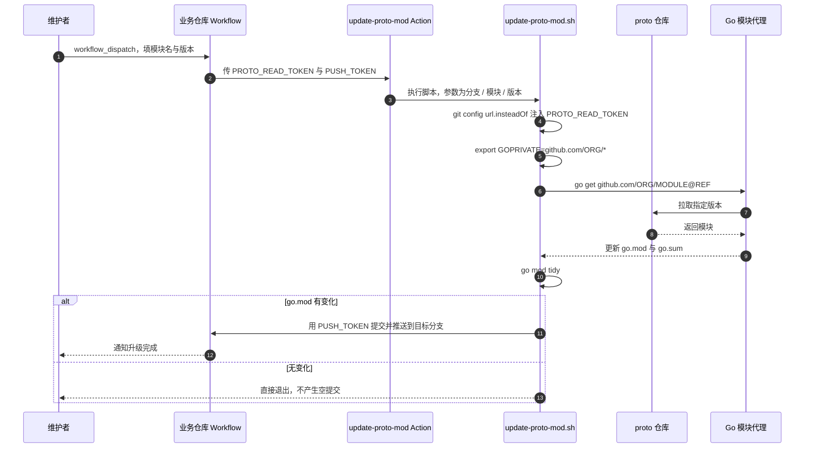

# 工作流列表与详细说明

> 本文是 [deploy-pipeline](../README.md) 文档的一部分。

## 📋 工作流列表

| 分类 | 工作流 | 文件路径 | 说明 |
|------|--------|----------|------|
| **共享** | Code Quality | `code-quality.yml` | 代码格式检查、静态分析、单元测试 |
| **共享** | Cleanup | `cleanup-artifacts.yml` | 清理 Actions artifacts 和 GHCR 旧镜像 |
| **后端** | Build Binary | `backend-build-binary.yml` | 编译 Go 二进制文件（支持 UPX 压缩） |
| **后端** | Build Docker | `backend-build-docker.yml` | 构建并推送后端 Docker 镜像（含 Summary 报告） |
| **后端** | Deploy K8s | `backend-deploy-k8s.yml` | 部署后端服务到 Kubernetes |
| **前端** | Build Frontend | `frontend-build-frontend.yml` | 前端构建（支持 npm/pnpm/yarn） |
| **前端** | Build Docker | `frontend-build-docker.yml` | 构建并推送前端 Docker 镜像（含 Summary 报告） |
| **前端** | Deploy K8s | `frontend-deploy-k8s.yml` | 部署前端应用到 Kubernetes |
| **通知** | Release Note | `release-note.yml` | tag 发布模式构建成功后自动生成 GitHub Release 发布单 |
| **通知** | PR Opened Notify | `pr-opened-notify.yml` | PR 开启时推送变更摘要到飞书/企微/TG |
| **通知** | PR Merged Notify | `pr-merged-notify.yml` | PR 合并后推送通知到飞书/企微/TG |
| **分支管理** | Branch Cut | `branch-cut.yml` | 从基线批量切出新分支（多仓库一次完成） |
| **分支管理** | Branch Recycle | `branch-recycle.yml` | dev 回收重切 + 已合并 feature 分支清理 |
| **共享** | Generate Pipeline Config | `generate-config.yml` | 按 schema 生成带注释的配置示例与密钥模板 |
| **Go 库** | Library Test | `go-library-test.yml` | Go 库的测试流水线：矩阵自动推导 + Build/Vet 闸门 |
| **Go 库** | Bump Upstream | `go-bump-upstream.yml` | 收到上游发版通知后升 go.mod，**过了闸门才推主干** |
| **Go 库** | Trigger Downstream | `go-trigger-downstream.yml` | 发 tag 后通知一级下游，清单由依赖图自动推导 |
| **Go 库** | Bootstrap | `golib-bootstrap.yml` | 体检并下发各库的接入状态与 App 凭证 |

> GitHub reusable workflow 的 `uses:` 目标必须直接位于 `.github/workflows/` 顶层，不能放在 `backend/`、`frontend/`、`shared/` 等二级目录。

---

## 📖 工作流详细说明


**跨仓库升级时序**：



> 两个令牌职责不同：`PROTO_READ_TOKEN` 只需要对 proto 仓库有读权限，
> `PUSH_TOKEN` 需要对**当前仓库**有写权限。混用一个全权令牌能跑通，
> 但一旦泄露影响面要大得多。


### 共享工作流

#### Code Quality

代码质量检查：gofmt + go vet + 单元测试 + 覆盖率报告

| 参数 | 类型 | 必填 | 默认值 | 说明 |
|------|------|------|--------|------|
| `go-version` | string | 否 | `1.25.1` | Go 版本 |
| `gotestsum-version` | string | 否 | `v1.13.0` | gotestsum 版本 |
| `goproxy` | string | 否 | `https://goproxy.cn\|direct` | Go 模块代理 |
| `goprivate` | string | 否 | `''` | 私有模块路径 |
| `go-auth-method` | string | 否 | `none` | 私有模块认证方式（同 Build Binary） |
| `retention-days` | string | 否 | `7` | 构建产物保留天数 |

**所需 Secrets（当 `goprivate` 非空时）：**

| Secret | 认证方式 | 说明 |
|--------|----------|------|
| `APP_ID` | `app-token` | GitHub App ID |
| `APP_PRIVATE_KEY` | `app-token` | GitHub App 私钥 |
| `GIT_SSH_PRIVATE_KEY` | `ssh` | SSH 私钥（Legacy） |

#### Cleanup

清理 Actions artifacts 和 GHCR 旧版本镜像，支持独立开关和按保留天数/版本数清理

**Artifacts 清理参数：**

| 参数 | 类型 | 必填 | 默认值 | 说明 |
|------|------|------|--------|------|
| `cleanup-artifacts` | boolean | 否 | `true` | 是否清理 Actions artifacts |
| `keep-days` | string | 否 | `7` | 保留最近 N 天的 artifacts |

**GHCR 镜像清理参数：**

| 参数 | 类型 | 必填 | 默认值 | 说明 |
|------|------|------|--------|------|
| `cleanup-images` | boolean | 否 | `false` | 是否清理 GHCR 镜像 |
| `project-owner` | string | 否 | `''` | GitHub 组织/用户名（cleanup-images 为 true 时必填） |
| `image-name` | string | 否 | `''` | 镜像名（逗号分隔多个，留空则自动扫描所有 container packages） |
| `keep-count` | string | 否 | `5` | 保留镜像版本数 |
| `tag-include-prefix` | string | 否 | `''` | 仅清理 tag 命中前缀的镜像版本（逗号分隔，如 `dev,uat,sit`）；每个前缀分组各自保留最新 `keep-count` 个；留空回退 `vars.CLEANUP_TAG_INCLUDE_PREFIX` |
| `tag-exclude-prefix` | string | 否 | `v,prod` | 永不清理 tag 命中前缀的镜像版本（逗号分隔），命中的版本也不占用保留名额；留空回退 `vars.CLEANUP_TAG_EXCLUDE_PREFIX`，仍未配置时默认豁免发布 tag 前缀 `v,prod`（发布镜像永不清理，保障可回滚） |

**调用示例：**

```yaml
# 只清理 artifacts
cleanup:
  uses: kamalyes/deploy-pipeline/.github/workflows/cleanup-artifacts.yml@master
  with:
    cleanup-artifacts: true
    keep-days: '7'

# 同时清理 artifacts + 指定镜像
cleanup:
  uses: kamalyes/deploy-pipeline/.github/workflows/cleanup-artifacts.yml@master
  with:
    cleanup-artifacts: true
    keep-days: '7'
    cleanup-images: true
    project-owner: 'your-org'
    image-name: 'your-service'
    keep-count: '5'

# 扫描清理所有镜像（image-name 留空）
cleanup:
  uses: kamalyes/deploy-pipeline/.github/workflows/cleanup-artifacts.yml@master
  with:
    cleanup-images: true
    project-owner: 'your-org'
    image-name: ''
    keep-count: '5'

# 清理多个指定镜像（逗号分隔）
cleanup:
  uses: kamalyes/deploy-pipeline/.github/workflows/cleanup-artifacts.yml@master
  with:
    cleanup-images: true
    project-owner: 'your-org'
    image-name: 'tenant-admin,ops-admin'
    keep-count: '5'
```

**Tag 前缀过滤说明：**

- 镜像 tag 由调用方在构建时拼接（如 `${branch}-${commit}-${timestamp}`），前缀即分支/环境名（dev/uat/sit…）
- `tag-include-prefix`（白名单）：仅清理命中前缀的版本，每个前缀各自保留最新 `keep-count` 个，避免高频环境把低频环境的保留名额挤掉；未命中任何前缀的版本（如 prod/master）不清理
- `tag-exclude-prefix`（黑名单）：命中前缀的版本永不清理；两者可同时配置，exclude 优先保护；**未配置时默认豁免发布 tag 前缀 `v,prod`，发布镜像（tag 发布模式产物）永不参与清理**
- untagged（dangling）版本不受前缀过滤影响，始终清理
- 配置优先级：`inputs > vars.CLEANUP_TAG_INCLUDE_PREFIX` / `vars.CLEANUP_TAG_EXCLUDE_PREFIX` > 默认值 `v,prod`（仅 exclude；仓库级 GitHub Variables 设置后无需修改 pipeline）

```yaml
# 只清理 dev/uat/sit 前缀的旧镜像，其他前缀（prod/master 等）不动
cleanup:
  uses: kamalyes/deploy-pipeline/.github/workflows/cleanup-artifacts.yml@master
  with:
    cleanup-images: true
    project-owner: 'your-org'
    keep-count: '5'
    tag-include-prefix: 'dev,uat,sit'

# 反向：清理所有旧镜像，但 prod/master 前缀的版本永不清理
cleanup:
  uses: kamalyes/deploy-pipeline/.github/workflows/cleanup-artifacts.yml@master
  with:
    cleanup-images: true
    project-owner: 'your-org'
    keep-count: '5'
    tag-exclude-prefix: 'prod,master'
```

#### Generate Pipeline Config

接入新服务时不用翻文档抄配置项：到 Actions 里手动触发它，带注释的默认配置会整份打到
job summary 里（明文那份 + 密钥骨架），顺手上传成 artifact，直接贴进仓库变量即可。
已经写好的配置也可以贴进来让它校验，省得推一次流水线才发现键名拼错。

| 入参 | 必填 | 默认 | 说明 |
|------|------|------|------|
| `mode` | ❌ | `generate` | `generate` 打印默认配置 / `validate` 校验 `config` 里贴进来的 YAML |
| `sections` | ❌ | `''` | 只要这几节（空格分隔），留空＝全部 |
| `config` | ❌ | `''` | `validate` 模式下待校验的 YAML |

`validate` 模式不用先说明「这是哪一节」：先按总表校，不匹配就逐节试一遍，
都不匹配才报错，并给出具体路径与「是否想写」建议。

generate 出来的东西自己会过一遍校验 —— 示例要是都通不过，说明配置表本身有问题。

### 分支管理工作流

周节奏 SOP 的分支工程化：周三上线发布后 dev 回收重切（git 树每周归零）+ 新迭代从最新 master 切 feature。

#### Branch Recycle（dev 回收重切 + 已合并 feature 清理）

**动作序列**（每仓库）：

1. 前置检查（可选开启）：今日存在 `prod-YYYY.MM.DD*` tag（确认发布已完成，未发布自动跳过）
2. dev 状态检查：`compare master...dev` 为 `identical/behind`（无未发布内容）才回收；`ahead/diverged` 自动**拒绝**并列出领先提交数（其他项目未发布变更，人工决策）
3. 删 dev → 从 master 重切（`dev` 不存在则直接新建，首次接入场景）
4. feature 清理：删除已完全合入 master 的 `feature/*` 分支，未合并的保留并列出

**安全设计**：

| 机制 | 说明 |
|---|---|
| 干跑预告 | 周三 21:00（北京时间）schedule 自动**干跑**，推预告卡片到群；真执行必须人工 `workflow_dispatch` 以 `dry-run=false` 确认——删分支永不无人值守 |
| 拒绝即停 | dev 领先 master（有未发布内容）自动拒绝该仓库，不误删其他项目变更 |
| 发布完成检查 | `require-today-tag=true` 时，今日无 `prod-*` tag 的仓库跳过（晚发布自动顺延到下次） |
| 幂等 | `dev` 缺失自动新建；重复触发安全 |

**触发方式**：

| 方式 | 场景 | dry-run |
|---|---|---|
| `schedule`（周三 21:00） | 自动干跑推预告卡片到群 | 恒为 true |
| `workflow_dispatch` | 人工确认执行（`dry-run=false`）或手动干跑 | 按 input |
| `workflow_call` | 单仓库自助模式（调用方 GITHUB_TOKEN 操作自己分支） | 按 input |

**参数**：

| 参数 | 类型 | 必填 | 默认值 | 说明 |
|------|------|------|--------|------|
| `repos` | string | 否 | `''` | 仓库列表（逗号分隔 owner/repo；留空回退 `branch.repos` 配置，再回退当前仓库） |
| `source-branch` | string | 否 | `master` | 源分支（重切基点） |
| `target-branch` | string | 否 | `dev` | 回收目标分支 |
| `feature-prefix` | string | 否 | `feature/` | 要清理的 feature 分支前缀 |
| `clean-features` | boolean | 否 | `true` | 是否清理已合并 feature 分支 |
| `require-today-tag` | boolean | 否 | call: `false` / dispatch: `true` | 是否要求今日存在 `prod-YYYY.MM.DD*` tag 才回收 |
| `dry-run` | boolean | 否 | call: `true` / dispatch: `false` | 干跑模式（schedule 恒为干跑） |
| `notification-provider` | string | 否 | `feishu` | 通知渠道：feishu / telegram / all / none |

**配置要求**（中心批量模式，在 deploy-pipeline 仓库配置一次）：

```yaml
# vars.PIPELINE_CONFIG（或 vars.BRANCH_CONFIG）
branch:
  repos: service-a,service-b,service-c
  source_branch: master
  target_branch: dev
  feature_prefix: feature/
  clean_features: true

# secrets.PIPELINE_SECRETS
branch:
  token: ghp_xxxx          # PAT 或 GitHub App token，需覆盖全部目标仓库
notify:
  feishu_webhook_url: https://open.feishu.cn/open-apis/bot/v2/hook/xxxx
```

旧式单个变量 `vars.BRANCH_OPS_REPOS` / `secrets.BRANCH_OPS_TOKEN` 仍然有效，
优先级在聚合 YAML 之下，详见[配置章节](#-配置一份聚合-yaml)。
`branch.token` 留空时回退本次运行的 `GITHUB_TOKEN`，那只够操作当前仓库，跨仓库批量会 404。

**调用示例**：

```yaml
# 单仓库自助模式（在业务仓库 pipeline.yml 中，用自己 GITHUB_TOKEN）
branch-recycle:
  uses: kamalyes/deploy-pipeline/.github/workflows/branch-recycle.yml@master
  with:
    clean-features: true
    dry-run: false
    notification-provider: 'feishu'
  secrets: inherit
```

```yaml
# 中心批量模式（在 deploy-pipeline 仓库手动 dispatch，或 schedule 自动预告）
# inputs.repos: service-a,service-b,service-c,...（留空用 branch.repos）
# dry-run=false 执行；require-today-tag=true 检查发布完成
```

#### Branch Cut（批量切分支）

新迭代启动（周三发布后定下版本内容）：从最新 master 给一批仓库统一切出 `feature/xx`。

| 参数 | 类型 | 必填 | 默认值 | 说明 |
|------|------|------|--------|------|
| `repos` | string | 否 | `''` | 仓库列表（逗号分隔；留空回退 `branch.repos` 配置） |
| `new-branch` | string | 是 | - | 新分支名（如 `feature/xxx`） |
| `base-branch` | string | 否 | `master` | 基分支 |
| `dry-run` | boolean | 否 | `false` | 干跑模式 |
| `notification-provider` | string | 否 | `feishu` | 通知渠道 |

幂等：目标分支已存在的仓库自动跳过。切完自动推结果卡片，替代群里人肉喊"大家切分支了"。

```yaml
# 在 deploy-pipeline 仓库手动 dispatch：new-branch=feature/xxx，repos 留空用 branch.repos
```

#### branch-ops.sh（脚本直用）

两个 workflow 共用 `scripts/branch-ops.sh`（workflow 里经 fetch-pipeline-assets 取到 `_deploy-workflows/scripts/branch-ops.sh`，本地直接跑仓库里的那份）：

```bash
export GH_TOKEN="<PAT>"                      # 跨仓库用 PAT；单仓库用 GITHUB_TOKEN
export BRANCH_OPS_REPOS="org/repo-a,org/repo-b"
export BRANCH_OPS_DRY_RUN=true               # 干跑

bash scripts/branch-ops.sh recycle            # 回收模式
# 附加 env: BRANCH_OPS_SOURCE / BRANCH_OPS_TARGET / BRANCH_OPS_FEATURE_PREFIX /
#          BRANCH_OPS_CLEAN_FEATURES / BRANCH_OPS_REQUIRE_TAG

bash scripts/branch-ops.sh cut                # 切分支模式
# 附加 env: BRANCH_OPS_NEW_BRANCH=feature/xxx / BRANCH_OPS_BASE=master
```

### 后端工作流

#### Build Binary

编译 Go 二进制文件，支持交叉编译和 UPX 压缩

| 参数 | 类型 | 必填 | 默认值 | 说明 |
|------|------|------|--------|------|
| `go-version` | string | 是 | - | Go 版本 |
| `binary-name` | string | 是 | - | 二进制文件名 |
| `binary-source-dir` | string | 是 | - | 二进制输出目录 |
| `binary-output` | string | 是 | - | 二进制完整输出路径 |
| `version` | string | 是 | - | 版本号 |
| `build-time` | string | 是 | - | 构建时间 |
| `git-commit` | string | 是 | - | Git commit hash |
| `goproxy` | string | 否 | `https://goproxy.cn\|direct` | Go 模块代理 |
| `goprivate` | string | 否 | `''` | 私有模块路径（如 `github.com/your-org/*`） |
| `go-auth-method` | string | 否 | `none` | 私有模块认证方式，详见下方说明 |
| `os` | string | 否 | `linux` | 目标操作系统 |
| `arch` | string | 否 | `amd64` | 目标架构（`amd64` 或 `arm64`，每次构建只产出对应架构一个二进制；K8s 集群含 arm64 节点时传 `arm64` 用 Go 交叉编译） |
| `upx-compress` | string | 否 | `false` | 是否启用 UPX 压缩 |
| `retention-days` | string | 否 | `7` | 构建产物保留天数 |

**所需 Secrets：**

| Secret | 认证方式 | 说明 |
|--------|----------|------|
| `APP_ID` | `app-token` | GitHub App ID |
| `APP_PRIVATE_KEY` | `app-token` | GitHub App 私钥 |
| `GIT_SSH_PRIVATE_KEY` | `ssh` | SSH 私钥（Legacy） |

---

#### 🔐 Go 私有模块认证（`go-auth-method`）

当项目依赖私有 Go 模块（通过 `goprivate` 指定）时，CI 需要认证才能拉取。`go-auth-method` 支持三种方式：

| 值 | 说明 | Secrets | 安全性 |
|-----|------|---------|--------|
| `app-token` | **推荐** — 使用 GitHub App 动态生成短期 Token | `APP_ID` + `APP_PRIVATE_KEY` | ⭐⭐⭐ Token 自动过期，权限可细粒度控制 |
| `ssh` | 传统方式 — 使用 SSH 私钥拉取 | `GIT_SSH_PRIVATE_KEY` | ⭐⭐ 私钥长期有效，需手动轮换 |
| `none` | 不需要认证（公开仓库或已有其他认证） | 无 | — |

**优先级链：** `input > vars.GO_AUTH_METHOD > 'none'`

**`app-token` 方式工作原理：**

1. 使用 `actions/create-github-app-token@v1` 由 `APP_ID` + `APP_PRIVATE_KEY` 生成临时 Token
2. 自动配置 `git config --global url."https://x-access-token:<token>@github.com/".insteadOf "https://github.com/"`
3. Token 仅在当前 Job 生命周期内有效，Job 结束自动失效

**GitHub App 配置步骤：**

1. 前往 GitHub → Settings → Developer settings → GitHub Apps → New GitHub App
2. 设置 Permissions：Contents → Read-only（拉取私有仓库）
3. 安装 App 到目标组织/仓库
4. 将 App ID 存入仓库 Secret `APP_ID`
5. 将 App 生成的 Private Key 存入仓库 Secret `APP_PRIVATE_KEY`

**`ssh` 方式工作原理：**

1. 使用 `webfactory/ssh-agent@v0.9.0` 加载 SSH 私钥
2. 配置 `git config --global url."git@github.com:".insteadOf "https://github.com/"`
3. 私钥永不过期，需定期手动轮换

**调用示例：**

```yaml
# 推荐：App Token 方式
build-binary:
  uses: kamalyes/deploy-pipeline/.github/workflows/backend-build-binary.yml@master
  with:
    binary-name: 'my-service'
    goprivate: 'github.com/my-org/*'
    go-auth-method: 'app-token'
  secrets:
    APP_ID: ${{ secrets.APP_ID }}
    APP_PRIVATE_KEY: ${{ secrets.APP_PRIVATE_KEY }}

# Legacy：SSH 方式
build-binary:
  uses: kamalyes/deploy-pipeline/.github/workflows/backend-build-binary.yml@master
  with:
    binary-name: 'my-service'
    goprivate: 'github.com/my-org/*'
    go-auth-method: 'ssh'
  secrets:
    GIT_SSH_PRIVATE_KEY: ${{ secrets.GIT_SSH_PRIVATE_KEY }}
```

#### Build Docker (Backend)

构建后端 Docker 镜像并推送到镜像仓库

| 参数 | 类型 | 必填 | 默认值 | 说明 |
|------|------|------|--------|------|
| `binary-name` | string | 是 | - | 二进制文件名 |
| `version` | string | 是 | - | 版本号 |
| `http-port` | string | 是 | - | HTTP 端口 |
| `rpc-port` | string | 是 | - | gRPC 端口 |
| `ws-port` | string | 否 | `''` | WebSocket 端口（可选） |
| `ws-deployment-mode` | string | 否 | `combined` | WebSocket 部署模式：combined（混合）或 separate（独立） |
| `ws-app-name` | string | 否 | `${binary-name}-ws` | WebSocket 独立部署的应用名称 |
| `pprof-port` | string | 是 | - | Pprof 端口 |
| `docker-registry` | string | 是 | - | 镜像仓库地址 |
| `binary-source-dir` | string | 是 | - | 二进制文件目录 |
| `image-base` | string | 是 | - | 基础镜像名（不带 tag） |
| `image-name` | string | 是 | - | 完整镜像名（带 tag） |
| `arch` | string | 否 | `amd64` | 目标架构（`amd64` 或 `arm64`），需与 build-binary 一致；build-push-action 用 `linux/${arch}` 标记 manifest，K8s 才能调度到对应架构节点 |
| `extra-copy-dirs` | string | 否 | `''` | 额外拷贝到 Docker 镜像的目录（逗号分隔，支持 `src:dest` 格式，如 `proto` 或 `proto:./proto,locales:./locales`） |

**所需 Secrets：**

| Secret | 必填 | 说明 |
|--------|------|------|
| `DOCKER_USERNAME` | 否 | 镜像仓库用户名，默认 `github.actor` |
| `DOCKER_PASSWORD` | 否 | 镜像仓库密码/Token，默认 `GITHUB_TOKEN` |

#### Deploy K8s (Backend)

部署后端服务到 Kubernetes 集群

| 参数 | 类型 | 必填 | 默认值 | 说明 |
|------|------|------|--------|------|
| `environment` | string | 是 | - | 部署环境（用作 K8s namespace） |
| `image-name` | string | 是 | - | 完整镜像名（带 tag） |
| `binary-name` | string | 是 | - | 服务名 |
| `kind` | string | 否 | `Deployment` | Kubernetes workload 类型：Deployment/StatefulSet/DaemonSet |
| `service-kind` | string | 否 | `Service` | Kubernetes Service kind 类型 |
| `service-type` | string | 否 | `ClusterIP` | Kubernetes Service 暴露类型：ClusterIP/NodePort/LoadBalancer |
| `http-port` | string | 是 | - | HTTP 端口 |
| `rpc-port` | string | 是 | - | gRPC 端口 |
| `ws-port` | string | 否 | `''` | WebSocket 端口（可选） |
| `pprof-port` | string | 是 | - | Pprof 端口 |
| `config-yaml` | string | 否 | `''` | 配置文件路径 |
| `configmap-name` | string | 否 | `''` | ConfigMap 名称 |
| `enable-hpa` | string | 否 | `true` | 是否启用 HPA |
| `ingress-path-prefix` | string | 否 | `''` | Ingress 路径前缀 |
| `notification-provider` | string | 否 | `none` | 通知方式：`none`/`feishu`/`wecom`/`telegram`/`all` |

**所需环境级 Secrets：**

| Secret | 必填 | 说明 |
|--------|------|------|
| `PIPELINE_SECRETS` | 否 | 聚合密钥 YAML，`kube.kubeconfig` 可代替下面的 `KUBECONFIG` |
| `KUBECONFIG` | 是（或由 `PIPELINE_SECRETS` 提供） | K8s 集群配置 |
| `FEISHU_WEBHOOK_URL` | 否 | 飞书通知 Webhook URL |
| `WECOM_WEBHOOK_URL` | 否 | 企业微信群机器人 Webhook URL（完整地址） |
| `WECOM_WEBHOOK_KEY` | 否 | 企业微信群机器人 key（与 URL 二选一） |
| `TELEGRAM_BOT_TOKEN` | 否 | Telegram Bot Token |
| `TELEGRAM_CHAT_ID` | 否 | Telegram 聊天群组 ID |

### 前端工作流

#### Build Frontend

前端构建，支持 npm、pnpm、yarn 三种包管理器

| 参数 | 类型 | 必填 | 默认值 | 说明 |
|------|------|------|--------|------|
| `node-version` | string | 是 | - | Node.js 版本 |
| `version` | string | 是 | - | 构建版本号 |
| `build-time` | string | 是 | - | 构建时间戳 |
| `git-commit` | string | 是 | - | Git commit hash |
| `package-manager` | string | 否 | `npm` | 包管理器：npm/pnpm/yarn |
| `package-registry` | string | 否 | `https://registry.npmmirror.com` | 包管理器仓库地址 |
| `build-command` | string | 否 | `npm run build` | 构建命令（monorepo 可传 `pnpm run build:xxx`） |
| `output-dir` | string | 否 | `dist` | 构建输出目录 |
| `artifact-name` | string | 否 | `frontend-dist` | 构建产物 Artifact 名称（多应用并行构建时需区分） |
| `pnpm-version` | string | 否 | `8` | pnpm 版本（仅 package-manager 为 pnpm 时生效） |
| `retention-days` | string | 否 | `7` | 构建产物保留天数 |

#### Build Docker (Frontend)

构建前端 Docker 镜像（基于 Nginx）

| 参数 | 类型 | 必填 | 默认值 | 说明 |
|------|------|------|--------|------|
| `app-name` | string | 是 | - | 前端应用名称 |
| `version` | string | 是 | - | 版本号 |
| `http-port` | string | 否 | `80` | HTTP 端口 |
| `docker-registry` | string | 是 | - | 镜像仓库地址 |
| `image-base` | string | 是 | - | 基础镜像名（不带 tag） |
| `image-name` | string | 是 | - | 完整镜像名（带 tag） |
| `base-image` | string | 否 | `nginx:1.25.3-alpine` | 基础 Nginx 镜像 |
| `nginx-config-path` | string | 否 | `''` | 项目自定义 nginx.conf 路径 |
| `artifact-name` | string | 否 | `frontend-dist` | 构建产物 Artifact 名称（需与 build-frontend 一致） |
| `os` | string | 否 | `linux` | 目标 OS |
| `arch` | string | 否 | `amd64` | 目标架构（`amd64` / `arm64`），与 `os` 拼成 `${os}/${arch}` 传给 build-push-action 的 platforms |

#### Deploy K8s (Frontend)

部署前端应用到 Kubernetes 集群

| 参数 | 类型 | 必填 | 默认值 | 说明 |
|------|------|------|--------|------|
| `environment` | string | 是 | - | 部署环境（用作 K8s namespace） |
| `image-name` | string | 是 | - | 完整镜像名（带 tag） |
| `app-name` | string | 是 | - | 应用名称 |
| `http-port` | string | 否 | `80` | HTTP 端口 |
| `ingress-path-prefix` | string | 否 | `''` | Ingress 路径前缀 |
| `enable-hpa` | string | 否 | `true` | 是否启用 HPA |
| `notification-provider` | string | 否 | `none` | 通知方式：`none`/`feishu`/`wecom`/`telegram`/`all` |

**所需环境级 Secrets：**

| Secret | 必填 | 说明 |
|--------|------|------|
| `KUBECONFIG` | 是 | K8s 集群配置 |
| `FEISHU_WEBHOOK_URL` | 否 | 飞书通知 Webhook URL |
| `WECOM_WEBHOOK_URL` | 否 | 企业微信群机器人 Webhook URL（完整地址） |
| `WECOM_WEBHOOK_KEY` | 否 | 企业微信群机器人 key（与 URL 二选一） |
| `TELEGRAM_BOT_TOKEN` | 否 | Telegram Bot Token |
| `TELEGRAM_CHAT_ID` | 否 | Telegram 聊天群组 ID |

---

---

## 📎 其余工作流的说明在别处

这些工作流有专门的文档，这里不重复，只给入口：

| 工作流 | 文件 | 看这里 |
|---|---|---|
| 🧪 Go Library Test | `go-library-test.yml` | [Go 库流水线](05-go-library-pipeline.md) |
| 📦 Go Bump Upstream | `go-bump-upstream.yml` | [Go 库流水线](05-go-library-pipeline.md) |
| 🔄 Go Trigger Downstream | `go-trigger-downstream.yml` | [Go 库流水线](05-go-library-pipeline.md) |
| 🧰 Go Library Bootstrap | `golib-bootstrap.yml` | [Go 库流水线](05-go-library-pipeline.md) |
| PR Opened Notify | `pr-opened-notify.yml` | [通知与发布单](07-notifications.md) |
| PR Merged Notify | `pr-merged-notify.yml` | [通知与发布单](07-notifications.md) |
| 📋 Release Note | `release-note.yml` | [通知与发布单](07-notifications.md) |

本仓库 `.github/workflows/` 下共 18 个工作流，上表 7 个加本文正文 11 个，覆盖齐全。
