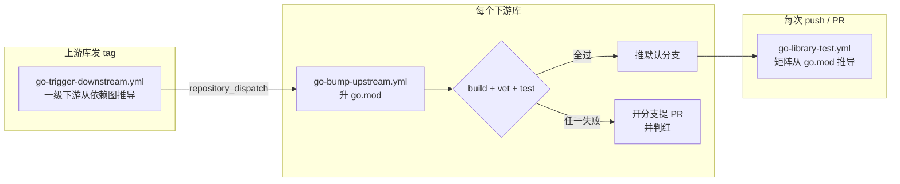

# Go 库流水线

> 本文是 [deploy-pipeline](../README.md) 文档的一部分。

## 📚 Go 库流水线

三十来个 Go 库原先每个仓库各自手写一套 CI，约八百行、分裂成五种方言。实际代价不是难维护，
而是**错误会静默发生**：

| 实际发生过的事 | 为什么没人发现 |
|---|---|
| 两个库的默认分支编译不过 | 测试步骤挂着 `continue-on-error`，日志里 `FAIL` 清清楚楚，workflow 照报 `success` |
| 某个库 `go vet` 一直是红的 | 它的 CI 里**根本没有 vet 这一步**，而 `go test` 只跑 vet 的一个子集 |
| 矩阵声明支持 Go 1.21–1.25 | `go.mod` 写的是 `go 1.25.0`，低于它的版本被工具链切换**静默顶成 1.25.0**，五个 job 实测同一个版本，输出全程正确、没有任何报错 |
| 一个库发版后下游拿不到 | 下游清单硬编码在各自的 `strategy.matrix` 里，手维护必然脱节 —— 实测有基础库真实一级下游二十来个却只通知到其中一个 |
| 九个库的上下游联动是死的 | 它们引用了某个 secret 但从没配上。跨仓库 dispatch 直接失败，而 bump 回落到 `GITHUB_TOKEN`，**用它推的提交不触发任何 workflow** |

这些都不是"忘了配"，而是**配置点太多、必然漏**。所以这套流水线的设计目标是：
**能自动推导的一律不让人配，关不掉的规则一律关不掉。**

### 三条工作流



| 工作流 | 触发 | 关不掉的规则 |
|---|---|---|
| `go-library-test.yml` | push / pull_request | Build 与 Vet 独立成步、跑在测试之前；测试步骤**绝不**挂 `continue-on-error`；矩阵声明与 `go version` 实报不一致就判红 |
| `go-bump-upstream.yml` | `repository_dispatch` | 升完依赖**必须** build + vet + test 通过才允许碰默认分支；没过就开分支提 PR 并判红 |
| `go-trigger-downstream.yml` | push tag `v*` | 下游清单从真实依赖图推导，漏通知在机制上不可能发生 |

### 不用配的部分

| 项 | 怎么来的 |
|---|---|
| **Go 版本矩阵** | 地板读 `go.mod` 的 `go` 指令，上限取 Go 官方当前发布的最新两个小版本。Go 发新版之后矩阵自己跟上 |
| **覆盖率上传由哪个版本承担** | 取矩阵里最高的那个。不写死版本号 —— 矩阵会随 Go 发新版上移，写死的值早晚匹配不到任何 job，于是覆盖率静默停止上传而 CI 仍然全绿 |
| **一级下游清单** | 枚举本账号下的仓库，读各自 `go.mod`，取**直接** require 本模块的那些。带 `// indirect` 的传递依赖不算，它们由自己的直接上游在各自那一跳通知到 |
| **运行平台** | 默认 `ubuntu-latest` |

于是绝大多数库的 `test.yml` 只剩这些：

```yaml
jobs:
  test:
    uses: kamalyes/deploy-pipeline/.github/workflows/go-library-test.yml@master
    secrets:
      CODECOV_TOKEN: ${{ secrets.CODECOV_TOKEN }}
```

### 要配的部分

**每个库仓库**只需要两个 Secret，而且可以由 `golib-bootstrap.yml` 下发，不必手点：

| Secret | 必需性 | 用途 |
|---|---|---|
| `APP_ID` | 参与上下游联动则必需 | 跨仓库 dispatch、推 `go.mod`、开 PR |
| `APP_PRIVATE_KEY` | 同上 | 同上 |
| `CODECOV_TOKEN` | 可选 | public 仓库免 token 也能上传；没配则上传步骤自己跳过，不影响流水线 |

> **为什么必须逐仓库存一份**：GitHub 的 Actions secret 只有组织级与仓库级，**没有个人账号级**
> 这一层。本仓库在个人账号下，凭证无法集中存放，这正是 `golib-bootstrap.yml` 存在的理由。
>
> 瘦入口里一律写**显式映射**而不是 `secrets: inherit`，原因见[上面那条](#inherit-cross-account)。

**本仓库**（deploy-pipeline）也存一份同样的 `APP_ID` / `APP_PRIVATE_KEY`，供 `golib-bootstrap.yml`
分发用。App 怎么建、要勾哪些权限项、安装范围怎么选，全在
[GitHub App 创建与配置](#-github-app-创建与配置)一节，那里的用途表已经按工作流列出了这套
流水线各自需要的权限。

### 用 bootstrap 一次配完

```bash
# 1. 先体检，只读不改（schedule 每周一也会自动跑一次）
gh workflow run golib-bootstrap.yml -R kamalyes/deploy-pipeline -f mode=audit

# 2. 看 job summary 里的表，确认范围无误后空跑一遍
gh workflow run golib-bootstrap.yml -R kamalyes/deploy-pipeline \
  -f mode=secrets -f dry-run=true

# 3. 真的下发
gh workflow run golib-bootstrap.yml -R kamalyes/deploy-pipeline \
  -f mode=secrets -f dry-run=false

# 4. 给还没接入的新库补齐三份瘦入口（模板在 templates/golib/）
gh workflow run golib-bootstrap.yml -R kamalyes/deploy-pipeline \
  -f mode=workflows -f dry-run=false
```

体检报告会逐仓库列出三份瘦入口的状态（`共用` / `自写` / `缺`）与 App 凭证是否配上。
`自写` 表示该仓库还留着自己手写的那份，没接共用流水线。

### 想偏离默认时

推导出来的值都能覆盖，优先级是 **分节 YAML > 总表 YAML > workflow input > 单个变量 > 默认值**：

```yaml
# vars.PIPELINE_CONFIG —— 一份总表批量配下来
golib:
  go_versions: '["1.25.x", "1.27.x"]'   # 显式指定矩阵
  platforms: '["ubuntu-latest", "macos-15"]'
  gofmt_check: false                     # 仓库还有存量未格式化文件时先关掉
  downstream_repos: go-wsc go-rpc-gateway
```

想让某一个仓库偏离总表，用**分节变量** `vars.GOLIB_CONFIG`（它压总表），不是裸的单个变量。

配了 `downstream_repos` 之后流水线仍会比对真实依赖图，缺漏就在 job summary 里点出来 ——
覆盖是允许的，但不会让你悄悄漏掉真实依赖者。

手动触发 `trigger-downstream` 时，`only_repos` 可以填**多个**仓库（逗号或空白分隔），
因为一次发版常常只需要先推几个关键下游而不是全部。

### 需要外部依赖的库

job 的 `services` 块不能由 input 动态生成，所以走 `setup-script`：

```yaml
    with:
      setup-script: |
        set -euo pipefail
        # 可用 $RUNNER_OS / $RUNNER_ARCH 分平台；写进 $GITHUB_PATH 的目录对后续步骤有效
        # 后台起的服务进程能活到后面的测试步骤
```

子模块测试走 `post-test-script`，它在主测试之后执行。

---
