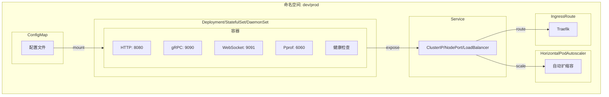
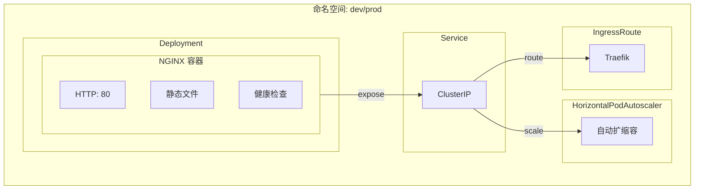
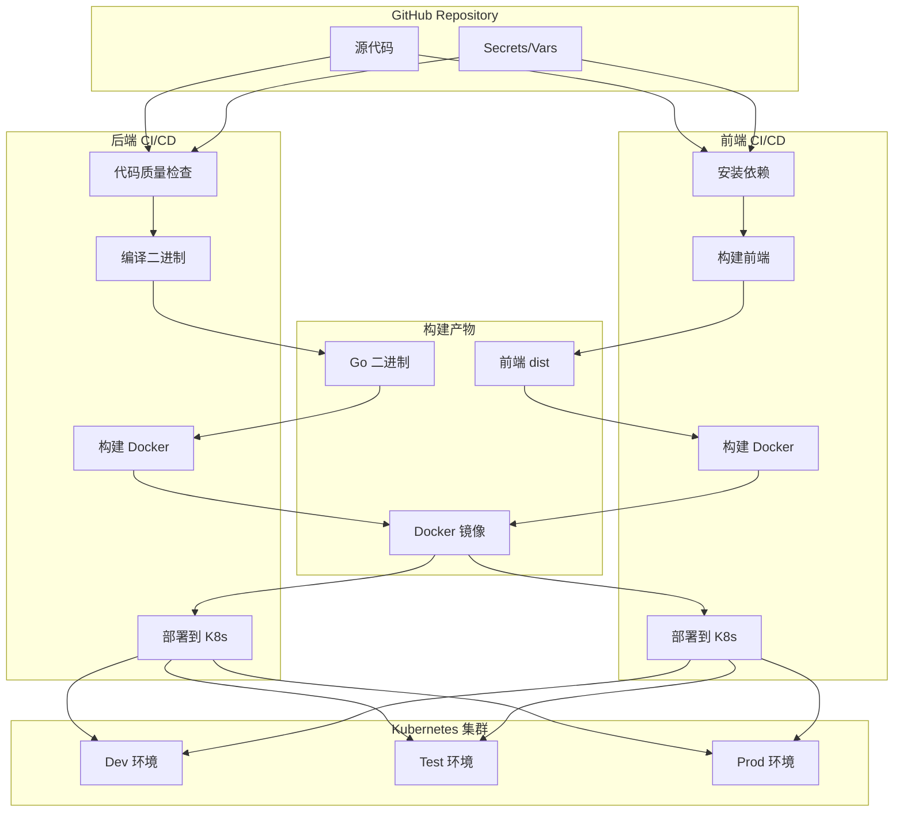
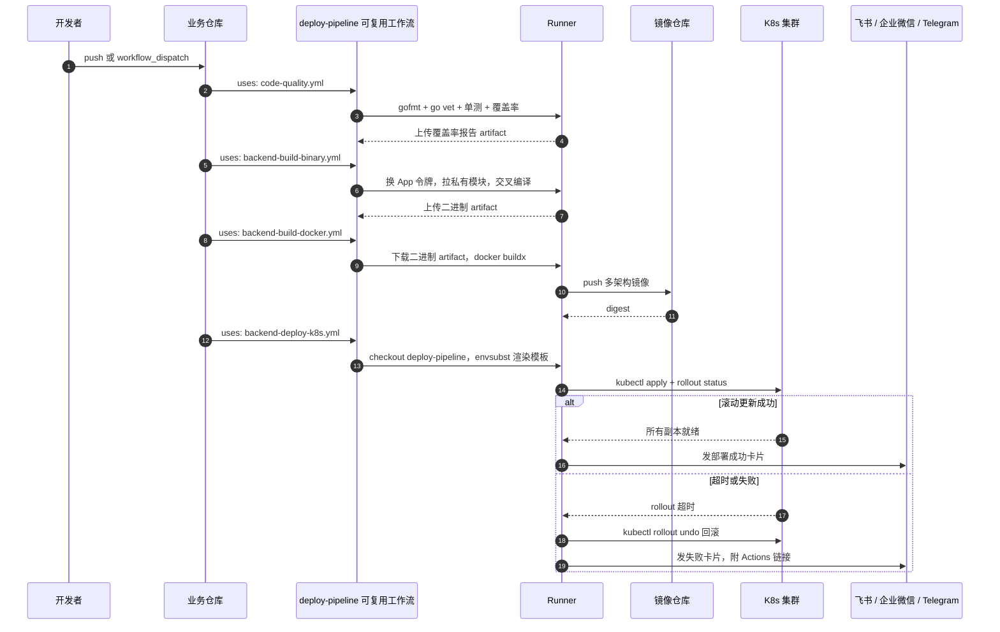
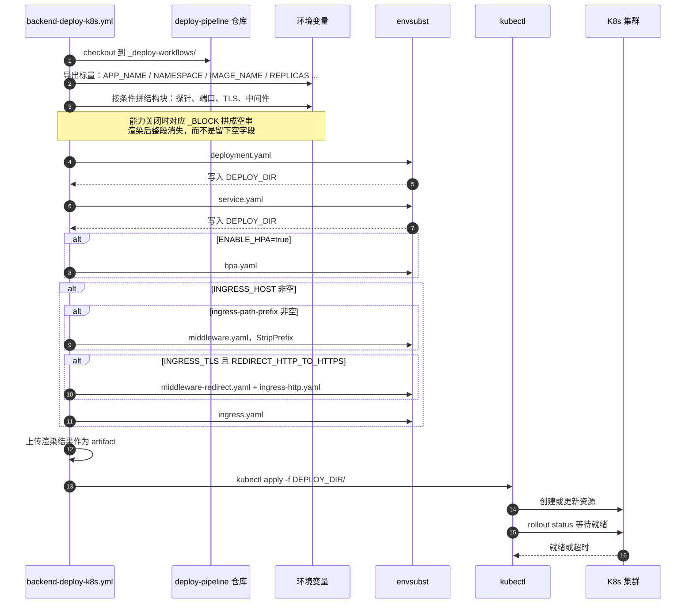

# K8s 部署架构与模板

> 本文是 [deploy-pipeline](../README.md) 文档的一部分

## 📊 K8s 部署架构

### 后端服务架构



### 前端应用架构



### CI/CD 流程图



---


### CI/CD 调用时序

上面的流程图讲「有哪些环节」，这张图讲「谁在什么时候调了谁」——
可复用工作流的交接点、产物在哪一步落地、通知在哪一步发出



> 每个 `uses:` 都是一次独立的 job 交接：产物只能通过 artifact 传递，环境变量与 Secret
> 不会自动跨 job 继承 —— 这就是为什么调用方必须显式写 `secrets:` 或 `secrets: inherit`

---

## 📦 K8s 模板清单与占位符

`templates/k8s/` 下的 12 个 yaml 不是直接 apply 的成品，而是 **envsubst 模板**
部署工作流会把本仓库 checkout 到 `_deploy-workflows/`，导出一堆环境变量，再逐个渲染

```text
deploy-pipeline checkout → _deploy-workflows/templates/k8s/<backend|frontend>/*.yaml
        ↓ export APP_NAME / NAMESPACE / IMAGE_NAME / ...（来自 inputs、vars、计算结果）
        ↓ envsubst < 模板 > ${DEPLOY_DIR}/<资源>.yaml
        ↓ kubectl apply -f ${DEPLOY_DIR}/
```

> ⚠️ **Ingress 相关模板是 Traefik CRD**（`traefik.io/v1alpha1` 的 `IngressRoute` 与
> `Middleware`），不是 k8s 原生 `Ingress`
> 集群里没装 Traefik 的话，这几个资源
> apply 会失败 —— 要么装 Traefik，要么 fork 掉这几个模板换成自己的 Ingress 实现

### 后端模板（templates/k8s/backend/）

| 模板 | 资源类型 | 渲染条件 | 作用 |
|------|---------|---------|------|
| `deployment.yaml` | `${KIND}`（Deployment / StatefulSet / DaemonSet）| 总是 | 主工作负载：镜像、探针、资源限额、端口、配置挂载、环境变量 |
| `service.yaml` | `${SERVICE_KIND}`（默认 Service）| 总是 | 服务暴露，端口按 HTTP / RPC / WS / pprof / node-grpc 分块拼装 |
| `hpa.yaml` | HorizontalPodAutoscaler | `ENABLE_HPA=true` | CPU + 内存双指标自动扩缩容 |
| `ingress.yaml` | Traefik IngressRoute | `INGRESS_HOST` 非空 | 主路由，按需带 TLS、StripPrefix 中间件、WebSocket 子路由 |
| `ingress-http.yaml` | Traefik IngressRoute | `INGRESS_TLS=true` 且 `INGRESS_REDIRECT_HTTP_TO_HTTPS=true` | 额外的 80 端口路由，专门用来跳转到 HTTPS |
| `middleware.yaml` | Traefik Middleware | `ingress-path-prefix` 非空 | StripPrefix，把 `/svc-a/xxx` 剥成 `/xxx` 再转给服务 |
| `middleware-redirect.yaml` | Traefik Middleware | 同 `ingress-http.yaml` | redirectScheme，HTTP → HTTPS |

### 前端模板（templates/k8s/frontend/）

| 模板 | 资源类型 | 渲染条件 | 作用 |
|------|---------|---------|------|
| `deployment.yaml` | Deployment | 总是 | 静态站点容器（Nginx），只有一个 HTTP 端口 |
| `service.yaml` | Service | 总是 | 单端口暴露 |
| `hpa.yaml` | HorizontalPodAutoscaler | `ENABLE_HPA=true` | 仅 CPU 指标 |
| `ingress.yaml` | Traefik IngressRoute | `INGRESS_HOST` 非空 | 主路由，按需带 TLS 与 StripPrefix |
| `middleware.yaml` | Traefik Middleware | `ingress-path-prefix` 非空 | StripPrefix |

后端比前端多出 `ingress-http.yaml` 与 `middleware-redirect.yaml`，因为后端对外常要同时
保留 80（跳转）和 443（服务）；前端站点一般由上层网关统一接管跳转

### 占位符从哪来

占位符分三类，排查「某个值怎么不对」时先认清它属于哪一类：

| 类别 | 例子 | 来源 |
|------|------|------|
| **标量值** | `APP_NAME`、`NAMESPACE`、`IMAGE_NAME`、`REPLICAS`、`CPU_LIMIT`、`MEMORY_LIMIT`、`RUN_MODE` | 工作流 inputs → 环境 vars → 默认值，逐级回退 |
| **结构块**（以 `_BLOCK` 结尾）| `DEPLOY_HTTP_PORT_BLOCK`、`SVC_RPC_PORT_BLOCK`、`LIVENESS_PROBE_BLOCK`、`TLS_BLOCK`、`MIDDLEWARES_BLOCK`、`EXTRA_ENV_BLOCK` | 工作流里按条件拼出的**多行 YAML 片段**；对应能力关闭时拼成空串，整段消失 |
| **计算值** | `INGRESS_MATCH_RULE`、`INGRESS_STRIP_PREFIX`、`GOMEMLIMIT_ENV_BLOCK` | 由其他值推导，如 `INGRESS_MATCH_RULE` 由 host 与 path-prefix 拼成 Traefik 规则 |

完整占位符清单：

| 模板 | 占位符 |
|------|--------|
| backend/deployment.yaml | `KIND` `APP_NAME` `NAMESPACE` `IMAGE_NAME` `IMAGE_PULL_POLICY` `IMAGE_PULL_SECRETS` `REPLICAS` `REVISION_HISTORY_LIMIT` `RUN_MODE` `CPU_REQUEST` `CPU_LIMIT` `MEMORY_REQUEST` `MEMORY_LIMIT` `CONFIGMAP_NAME` `CONFIG_MOUNT_PATH` `TERMINATION_GRACE_PERIOD_SECONDS` `ANNOTATIONS_BLOCK` `DEPLOY_HTTP_PORT_BLOCK` `DEPLOY_RPC_PORT_BLOCK` `DEPLOY_WS_PORT_BLOCK` `DEPLOY_PPROF_PORT_BLOCK` `DEPLOY_NODE_GRPC_PORT_BLOCK` `LIVENESS_PROBE_BLOCK` `READINESS_PROBE_BLOCK` `STARTUP_PROBE_BLOCK` `EXTRA_ENV_BLOCK` `GOMEMLIMIT_ENV_BLOCK` |
| backend/service.yaml | `SERVICE_KIND` `SERVICE_TYPE` `APP_NAME` `NAMESPACE` `SVC_HTTP_PORT_BLOCK` `SVC_RPC_PORT_BLOCK` `SVC_WS_PORT_BLOCK` `SVC_PPROF_PORT_BLOCK` `SVC_NODE_GRPC_PORT_BLOCK` |
| backend/hpa.yaml | `APP_NAME` `NAMESPACE` `MIN_REPLICAS` `MAX_REPLICAS` `TARGET_CPU_UTILIZATION` `TARGET_MEMORY_UTILIZATION` |
| backend/ingress.yaml | `APP_NAME` `NAMESPACE` `INGRESS_ENTRY_POINT` `INGRESS_MATCH_RULE` `INGRESS_PORT` `INGRESS_WS_ROUTE_BLOCK` `MIDDLEWARES_BLOCK` `TLS_BLOCK` |
| backend/ingress-http.yaml | `APP_NAME` `NAMESPACE` `INGRESS_MATCH_RULE` `INGRESS_PORT` `INGRESS_WS_ROUTE_BLOCK` `INGRESS_REDIRECT_MIDDLEWARE` |
| backend/middleware.yaml | `NAMESPACE` `INGRESS_STRIP_NAME` `INGRESS_STRIP_PREFIX` |
| backend/middleware-redirect.yaml | `APP_NAME` `NAMESPACE` |
| frontend/deployment.yaml | `APP_NAME` `NAMESPACE` `IMAGE_NAME` `IMAGE_PULL_POLICY` `IMAGE_PULL_SECRETS` `REPLICAS` `REVISION_HISTORY_LIMIT` `RUN_MODE` `HTTP_PORT` `CPU_REQUEST` `CPU_LIMIT` `MEMORY_REQUEST` `MEMORY_LIMIT` `CONFIGMAP_NAME` `CONFIG_MOUNT_PATH` `LIVENESS_DELAY` `LIVENESS_PERIOD` `READINESS_DELAY` `READINESS_PERIOD` |
| frontend/service.yaml | `APP_NAME` `NAMESPACE` `HTTP_PORT` |
| frontend/hpa.yaml | `APP_NAME` `NAMESPACE` `MIN_REPLICAS` `MAX_REPLICAS` `TARGET_CPU_UTILIZATION` |
| frontend/ingress.yaml | `APP_NAME` `NAMESPACE` `HTTP_PORT` `INGRESS_ENTRY_POINT` `INGRESS_MATCH_RULE` `MIDDLEWARES_BLOCK` `TLS_BLOCK` |
| frontend/middleware.yaml | `NAMESPACE` `INGRESS_STRIP_NAME` `INGRESS_STRIP_PREFIX` |

### 渲染与部署时序



### 怎么定制

| 想做什么 | 做法 |
|---------|------|
| 只调数值（副本数、限额、探针延迟）| 配对应的 input 或环境 Variable，别动模板 |
| 加一个固定的 annotation / label | 用 `ANNOTATIONS_BLOCK` 之类的块输入，仍然不用动模板 |
| 换 Ingress 实现（Nginx Ingress / Gateway API）| fork 本仓库改 `templates/k8s/*/ingress*.yaml` 与 `middleware*.yaml`，业务侧把 `uses:` 指到你的 fork |
| 加一种全新资源（如 ServiceMonitor）| 在 `templates/k8s/<side>/` 加模板，并在对应 deploy 工作流里补 envsubst 与 apply |

调试建议：部署工作流会把渲染后的 yaml 作为 artifact 上传，出问题时先下载它看实际渲染结果 ——
绝大多数「apply 报错」都是某个 `_BLOCK` 拼出来缩进不对，直接看成品比猜变量快

---
